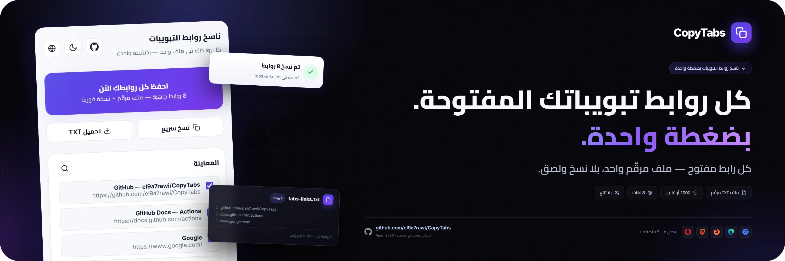
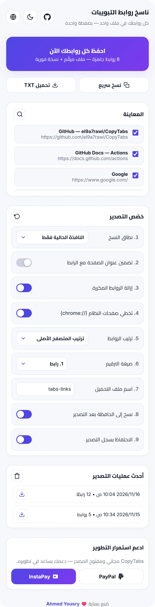
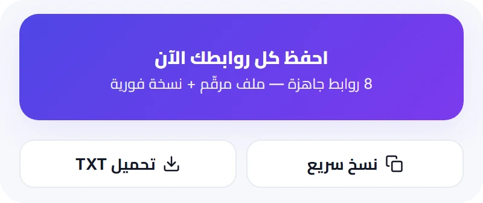
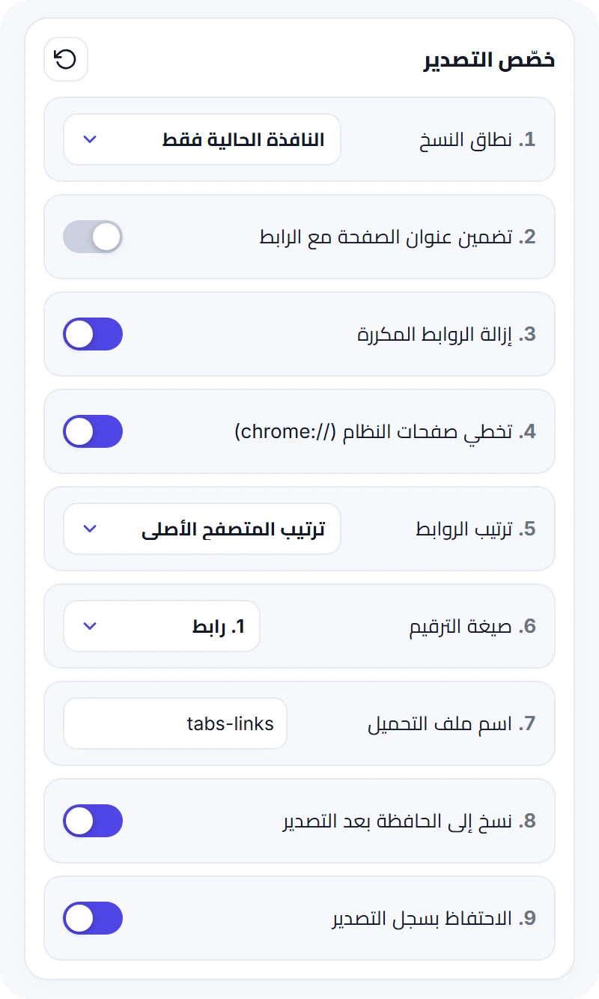

<p align="center">
  
</p>

<h1 align="center">CopyTabs — ناسخ روابط التبويبات بضغطة واحدة</h1>

<p align="center">فتحت خمسة عشر تبويبًا في جلسة بحث واحدة؟ يجمع CopyTabs كل رابط مفتوح في ملف <code>.txt</code> مرقّم واحد، ويضع نسخة في حافظتك بضغطة واحدة — بلا نسخ ولصق يدوي، ويعمل أوفلاين بالكامل. الواجهة عربية RTL بالكامل، وتأتي بثماني لغات، والإنجليزية هي الافتراضية.</p>

<p align="center">
  <a href="https://github.com/el9a7rawi/CopyTabs/releases"></a>
  <a href="https://github.com/el9a7rawi/CopyTabs/blob/main/LICENSE"></a>
  <a href="https://github.com/el9a7rawi/CopyTabs/pulls"></a>
  <a href="https://developer.chrome.com/docs/extensions"></a>
  
  
</p>

<p align="center">
  <sub><b>Languages:</b> <a href="README.md">English</a> · <a href="README.es.md">Español</a> · <a href="README.fr.md">Français</a> · <a href="README.de.md">Deutsch</a> · <a href="README.pt-BR.md">Português (Brasil)</a> · <a href="README.ru.md">Русский</a> · <a href="README.ar.md"><b>العربية</b></a> · <a href="README.zh-CN.md">中文（简体）</a></sub>
</p>

<p align="center">
  
</p>

<h3 align="center">حمّل الإضافة لمتصفحك — اضغط على الأيقونة</h3>

<div align="center">

| [<br><b>Chrome</b>](https://github.com/el9a7rawi/CopyTabs/releases/latest) | [<br><b>Edge</b>](https://github.com/el9a7rawi/CopyTabs/releases/latest) | [<br><b>Firefox</b>](https://github.com/el9a7rawi/CopyTabs/releases/latest) | [<br><b>Brave</b>](https://github.com/el9a7rawi/CopyTabs/releases/latest) | [<br><b>Opera</b>](https://github.com/el9a7rawi/CopyTabs/releases/latest) |
|---|---|---|---|---|

</div>

<p align="center">
  
</p>

---

## 1. لماذا CopyTabs؟

<div align="center" dir="rtl">

| بدون CopyTabs | مع CopyTabs |
|---|---|
| تنسخ كل رابط يدويًا وتلصقه في ملف | ضغطة واحدة تجمع كل الروابط، مرقّمة جاهزة |
| جلسة بحث كاملة تضيع عند إغلاق المتصفح | ملف محفوظ + نسخة في الحافظة + سجل تصدير |
| روابط مكررة وصفحات نظام لا تحتاجها | إزالة المكرر وتخطي صفحات النظام تلقائيًا |

</div>

<div dir="ltr">

```text
1. https://www.google.com/
2. https://developer.chrome.com/docs/extensions/
3. https://github.com/
```

</div>

---

## 2. كيف يعمل — ثلاث خطوات

1. **افتح** CopyTabs من شريط أدوات المتصفح: تظهر كل التبويبات المفتوحة، مع عدّاد حي في تلميح الزر الرئيسي.
2. **اضغط** الزر الرئيسي، أو راجع المعاينة واختر الروابط التي تريدها بمفتاح مستقل لكل رابط.
3. **شارك** — يُحمَّل ملف `.txt` فورًا، ويصل النص نفسه إلى حافظتك، وتبقى نسخة في سجل التصديرات.

---

## 3. جولة في الواجهة

### 3.1 أزرار التصدير الثلاثة

<p align="center"></p>

- **احفظ كل روابطك الآن** — الإجراء الرئيسي: يصدّر الروابط المحددة، ويحمّل الملف، وينسخ النص إلى الحافظة بضغطة واحدة، مع عدّاد حي للروابط الجاهزة أسفله.
- **نسخ سريع** — نسخ إلى الحافظة فقط، بلا تحميل ملف.
- **تحميل TXT** — ملف فقط، بلا كتابة في الحافظة.
- سطر الحالة تحت الأزرار يؤكد النجاح أو يشرح الخطأ — ويختفي تمامًا حين لا يوجد ما يُقال، فلا يترك فراغًا.

### 3.2 المعاينة والبحث الحي

- لكل رابط بطاقة خاصة: العنوان، والرابط، ومفتاح مستقل — إلغاء تحديد رابط يستبعده من التصدير.
- أيقونة العدسة تتوسع إلى حقل بحث بانتقال ناعم، وتُرشّح المعاينة **أثناء الكتابة** بالعنوان أو الرابط.
- زر **×** المتمركز يمسح النص ويُبقي الشريط مفتوحًا؛ أغلقه بالأيقونة مرة أخرى أو بمفتاح `Escape`.
- تُعرض الروابط من اليسار إلى اليمين حتى لا تنكسر داخل الواجهة العربية.

### 3.3 تخصيص التصدير

<p align="center"></p>

- **ثلاث قوائم مخصصة** بتصميمها الخاص (لا قوائم النظام الافتراضية): نطاق النسخ، وترتيب الروابط، وصيغة الترقيم — وكلها تعمل بلوحة المفاتيح وقارئ الشاشة.
- **مفاتيح تبديل**: تضمين عنوان الصفحة، وإزالة المكرر، وتخطي صفحات النظام، والنسخ التلقائي إلى الحافظة، والاحتفاظ بسجل التصدير.
- **حقل اسم الملف** (حتى 60 حرفًا، مع تنظيف تلقائي للرموز غير الصالحة وبصمة تاريخ تلقائية).
- زر **إعادة الضبط** (السهم الدائري أعلى القسم) يعيد كل خيار إلى قيمته الافتراضية.
- القائمة الكاملة للخيارات في القسم 5 أدناه.

### 3.4 أحدث عمليات التصدير

- آخر **10 عمليات تصدير**: التاريخ، والوقت، وعدد الروابط في كل مرة.
- زر **تحميل** لكل نسخة محفوظة، وزر **مسح السجل** (أيقونة سلة المهملات) أعلى القسم.
- حالة فارغة ودودة قبل أول تصدير — تظهر أول عملية هنا بمجرد انتهائها.

### 3.5 وضع داكن أسود حقيقي

خلفية سوداء فعلية (`#000000`) بتباين مضبوط، تُبدَّل بأيقونة الشمس/القمر في الهيدر وتُحفظ تلقائيًا.

### 3.6 قوائم بتصميمها الخاص

لا قوائم ويندوز افتراضية: النطاق والترتيب والترقيم لوحات عائمة أنيقة بعلامة اختيار، ودعم كامل للوحة المفاتيح، وتسميات لقارئ الشاشة.

### 3.7 دعم استمرار التطوير

- قسم اختياري لمن يريد دعم المشروع — يبقى CopyTabs مجانيًا ومفتوح المصدر.
- زر InstaPay مميز وPayPal كبديل — كلاهما يفتح في تبويب جديد، والإضافة لا ترسل أي بيانات.

---

## 4. ثماني لغات — الإنجليزية افتراضيًا وRTL كما يجب

- **الإنجليزية هي الافتراضية.** في أول تشغيل يتبع CopyTabs لغة المتصفح إن كانت إحدى الثماني، ثم يتذكر اختيارك الصريح بعد ذلك.
- **بدّل فورًا** من أيقونة الكرة الأرضية في الهيدر — بلا إعادة تحميل أو إعادة تشغيل. يُحفظ الاختيار في كائن الإعدادات نفسه مع بقية الخيارات.
- **ثمانية قواميس كاملة**: English، Español، Français، Deutsch، Português (Brasil)، Русский، العربية، 中文（简体）. كل نص — الأزرار والخيارات ورسائل الحالة والسجل — مترجم؛ لا شيء يرتد إلى الإنجليزية في منتصف الشاشة.
- **RTL حقيقي، لا انعكاس شكلي.** اختيار العربية يقلب اتجاه المستند منطقيًا: الهيدر وحقل البحث والقوائم والأيقونات والمفاتيح تنتقل إلى جهاتها الصحيحة، وتبقى الروابط من اليسار إلى اليمين داخل بطاقاتها.
- **جمع عربي حقيقي.** تُنسَّق الأعداد بقواعد `Intl.PluralRules`، فتحصل العربية على صيغها الكاملة (صفر/واحد/اثنان/قليل/كثير/آخر)، والروسية على صيغها الأربع، والصينية على صيغتها الواحدة — بلا «1 روابط» في أي مكان.
- **أوفلاين بالكامل.** كل قاموس يأتي داخل الإضافة؛ تبديل اللغة لا يرسل أي طلب شبكة.
- **لكل لغة README خاص بها** بصور من واجهتها — استخدم منتقي اللغات أعلى الصفحة.

---

## 5. عشرة خيارات تصنع كل تصدير

1. **النطاق** — النافذة الحالية فقط، أو كل النوافذ.
2. **تضمين عنوان الصفحة** — السطر بصيغة `1. العنوان — الرابط`.
3. **إزالة الروابط المكررة** — تُطبَّق تلقائيًا قبل التصدير.
4. **تخطي صفحات النظام** — يتجاهل صفحات المتصفح الداخلية (`chrome://` أو `edge://` أو `about:` وما شابه حسب متصفحك).
5. **ترتيب الروابط** — ترتيب المتصفح الأصلي، أو أبجدي، أو حسب النطاق.
6. **صيغة الترقيم** — `1.` أو `1)` أو `-`.
7. **اسم ملف مخصص** — مع بصمة تاريخ تلقائية: `tabs-links-YYYY-MM-DD.txt`.
8. **النسخ التلقائي إلى الحافظة** — بعد كل تصدير.
9. **الوضع الداكن** — زر الشمس/القمر في الهيدر، ويُحفظ تلقائيًا.
10. **سجل التصديرات** — آخر 10 عمليات، مع إعادة التحميل وزر مسح.

وفوق ذلك: بحث حي، ومفتاح مستقل لكل رابط، وشارة عدد على شريط الأدوات، وقائمة سياق، واختصران لوحة مفاتيح، وزر إعادة ضبط.

---

## 6. أمثلة ملف التصدير

بدون العناوين:

<div dir="ltr">

```text
1. https://www.google.com/
2. https://developer.chrome.com/docs/extensions/
3. https://github.com/
```

</div>

مع تفعيل **تضمين عنوان الصفحة**:

<div dir="ltr">

```text
1. Google — https://www.google.com/
2. Chrome Extensions — https://developer.chrome.com/docs/extensions/
```

</div>

---

## 7. التثبيت — دقيقة واحدة

افتح صفحة [الإصدارات](https://github.com/el9a7rawi/CopyTabs/releases) وحمّل أحدث بناء — **أرشيف واحد لكل متصفح**: Chrome وEdge وBrave وOpera وFirefox (أرشيفات Chromium الأربعة متطابقة، بينما يحمل أرشيف Firefox إعدادات Gecko).

**Chrome / Edge / Brave / Opera** (الملف `copytabs-<browser>-vX.Y.Z.zip` — مثلًا `copytabs-edge-v1.3.0.zip`):

1. فك ضغط الأرشيف.
2. افتح `chrome://extensions` (أو الصفحة المكافئة) وفعّل **وضع المطور**.
3. اختر **تحميل غير مضغوط**، وحدد المجلد، ثم ثبّت الأيقونة على شريط الأدوات.

**Firefox** (الملف `copytabs-firefox-vX.Y.Z.zip`):

1. فك ضغط الأرشيف.
2. افتح `about:debugging` ← This Firefox ← Load Temporary Add-on ← واختر `manifest.json`.
3. البناء الموقّع متاح دائمًا على صفحة AMO (قريبًا).

**للمطورين من المصدر:** اعمل `git clone` للمستودع، ثم حمّل المجلد مباشرة كإضافة غير مضغوطة لمتصفحات Chromium؛ ولـFirefox استخدم ناتج البناء (`python tools/build.py`) — manifest المصدر يأتي بلا `background.scripts` (مطلوب لـChrome).

> بلا خطوة بناء، بلا اعتماديات — كل تعديل في الكود يحتاج فقط **Reload** من صفحة الإضافات. المتطلبات: Chrome / Edge / Brave / Opera / Firefox 121 أو أحدث.

---

## 8. الخصوصية أولًا

<div align="center" dir="rtl">

| المبدأ | كيف يُطبَّق |
|---|---|
| يعمل أوفلاين بالكامل | صفر طلبات شبكة |
| أقل صلاحيات ممكنة | `tabs` و`storage` و`contextMenus` و`downloads` فقط |
| بياناتك تبقى على جهازك | الإعدادات والسجل في `storage.local` — لا يُرسل أي رابط إلى أي سيرفر |

</div>

---

## 9. الأسئلة الشائعة

**9.1 هل يعمل دون اتصال بالإنترنت؟**
نعم، بالكامل؛ المورد الخارجي الوحيد هو ملف أنماط خطوط Inter وCairo من Google Fonts، وتعود الإضافة إلى خطوط النظام تلقائيًا عند تعذّره. كل قاموس لغة مضمّن محليًا.

**9.2 هل تُجمع أي بيانات عني؟**
لا. الإضافة لا تحتوي أي كود شبكة على الإطلاق — ويمكنك التحقق من ذلك بنفسك في المصدر.

**9.3 كيف أغيّر صيغة الترقيم؟**
افتح *خصّص التصدير ← صيغة الترقيم*: `1.` أو `1)` أو `-`.

**9.4 لماذا يغيب تبويب من التصدير؟**
تأكد أنه ما زال محددًا في المعاينة، وأنه ليس صفحة نظام اخترت تخطيها، وأنه لم يُحذف كمكرر.

**9.5 كيف أغيّر لغة الواجهة؟**
اضغط أيقونة الكرة الأرضية في الهيدر واختر اللغة. الافتراضي الإنجليزية؛ يتبع أول تشغيل لغة متصفحك إن كانت مدعومة، ثم يُحفظ اختيارك بعد ذلك.

---

## 10. للمطورين

<div dir="ltr">

```text
├── manifest.json      ← single source MV3 manifest (the build emits one variant per browser)
├── popup.html/css/js  ← the interface (Inter first, Cairo/Tajawal for Arabic, logical RTL)
├── i18n.js            ← locale loader, plural rules, direction switching
├── browser.js         ← host browser detection + shared system-page prefixes
├── locales/           ← eight complete dictionaries (en, es, fr, de, pt-BR, ru, ar, zh-CN)
├── background.js      ← one shared background: service_worker, emitted as scripts for Firefox
├── icons/             ← 16 / 32 / 48 / 128
├── assets/            ← README screenshots (one folder per language) + browser icons
├── tools/build.py     ← store builds + SHA256 (used by CI and releases)
├── tools/check_locales.py ← key parity, plural categories, placeholder validation
└── tools/screenshots.py   ← regenerates every README screenshot from the real popup
```

</div>

الإنجليزية افتراضيًا مع ثمانية قواميس مضمّنة وتخطيط RTL منطقي، و`textContent` فقط عند عرض البيانات (لا `innerHTML` أبدًا)، والإعدادات في `chrome.storage.local`. تحقق سريع:

<div dir="ltr">

```powershell
python3 -c "import json; json.load(open('manifest.json')); print('manifest OK')"
python3 tools/check_locales.py
```

</div>

---

## 11. الرخصة والمساهمة

المشروع مفتوح المصدر ومجاني للجميع تحت رخصة **Apache-2.0** — استخدمه وعدّله وشاركه بحرية؛ النص الكامل في [LICENSE](LICENSE).

المساهمات مرحّب بها: افتح issue للبلاغات والأفكار، أو أرسل pull request مباشرة — تتحقق CI من manifest وكل رابط صورة قبل الدمج.

---

<p align="center">صُنع بعناية بواسطة <b>Ahmed Yousry</b> · <a href="LICENSE">Apache-2.0</a></p>
