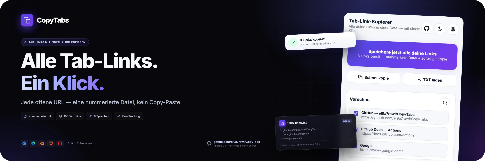
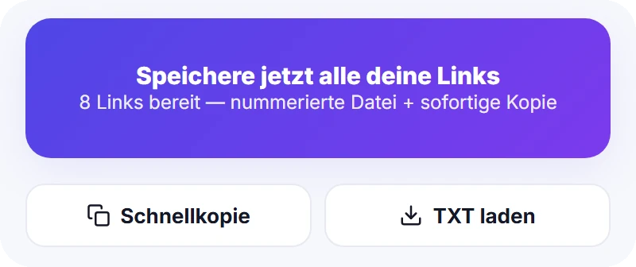
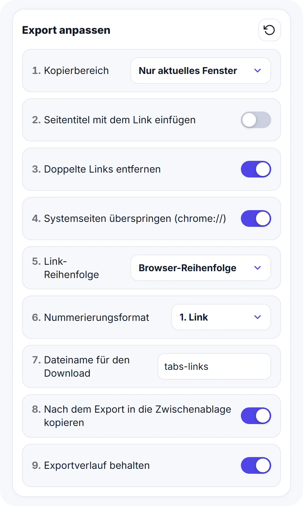

<p align="center">
  
</p>

<h1 align="center">CopyTabs — Tab-Links mit einem Klick kopieren</h1>

<p align="center">Fünfzehn offene Tabs für eine einzige Recherche? CopyTabs sammelt jede offene URL mit einem Klick in einer einzigen nummerierten <code>.txt</code>-Datei und in deiner Zwischenablage — ohne manuelles Kopieren und Einfügen, vollständig offline. Die Oberfläche ist standardmäßig englisch, kommt mit acht Sprachen und spiegelt sich vollständig für Arabisch (RTL).</p>

<p align="center">
  <a href="https://github.com/el9a7rawi/CopyTabs/releases"></a>
  <a href="https://github.com/el9a7rawi/CopyTabs/blob/main/LICENSE"></a>
  <a href="https://github.com/el9a7rawi/CopyTabs/pulls"></a>
  <a href="https://developer.chrome.com/docs/extensions"></a>
  
  
</p>

<p align="center">
  <a href="README.md">English</a> · <a href="README.es.md">Español</a> · <a href="README.fr.md">Français</a> · <a href="README.de.md"><b>Deutsch</b></a> · <a href="README.pt-BR.md">Português (Brasil)</a> · <a href="README.ru.md">Русский</a> · <a href="README.ar.md">العربية</a> · <a href="README.zh-CN.md">中文（简体）</a>
</p>

<h3 align="center">Für deinen Browser herunterladen — auf das Symbol klicken</h3>

<div align="center">

| [<br><b>Chrome</b>](https://github.com/el9a7rawi/CopyTabs/releases/latest) | [<br><b>Edge</b>](https://github.com/el9a7rawi/CopyTabs/releases/latest) | [<br><b>Firefox</b>](https://github.com/el9a7rawi/CopyTabs/releases/latest) | [<br><b>Brave</b>](https://github.com/el9a7rawi/CopyTabs/releases/latest) | [<br><b>Opera</b>](https://github.com/el9a7rawi/CopyTabs/releases/latest) |
|---|---|---|---|---|

</div>

---

## 1. Warum CopyTabs?

<div align="center">

| Ohne CopyTabs | Mit CopyTabs |
|---|---|
| Jede URL von Hand kopieren und in eine Datei einfügen | Ein Klick sammelt alle Links, schon nummeriert |
| Eine Recherche ist beim Schließen des Browsers verloren | Eine gespeicherte Datei, eine Kopie in der Zwischenablage und ein Verlauf |
| Doppelte Links und interne Seiten, die du nie wolltest | Duplikate entfernt und Systemseiten automatisch übersprungen |

</div>

<div dir="ltr">

```text
1. https://www.google.com/
2. https://developer.chrome.com/docs/extensions/
3. https://github.com/
```

</div>

---

## 2. So funktioniert es — drei Schritte

1. **Öffne** CopyTabs in der Browser-Symbolleiste: Jeder offene Tab erscheint mit einer Live-Zahl unter dem Hauptbutton.
2. **Klicke** auf die Hauptaktion oder prüfe die Vorschau und wähle einzelne Links über ihren eigenen Schalter.
3. **Teile** — die `.txt`-Datei wird sofort heruntergeladen, derselbe Text landet in der Zwischenablage und eine Kopie bleibt im Verlauf.

---

## 3. Rundgang durch die Oberfläche

### 3.1 Die drei Export-Aktionen

<p align="center"></p>

- **Speichere jetzt alle deine Links** — die Hauptaktion: exportiert die ausgewählten Links, lädt die Datei herunter und kopiert den Text mit einem Klick in die Zwischenablage, mit Live-Zähler darunter.
- **Schnellkopie** — nur Zwischenablage, keine Datei.
- **TXT laden** — nur Datei, kein Schreiben in die Zwischenablage.
- Eine Statuszeile unter den Buttons bestätigt den Erfolg oder erklärt den Fehler — und verschwindet ganz, wenn es nichts zu sagen gibt.

### 3.2 Live-Vorschau und Suche

- Jeder Link hat seine eigene Karte: Titel, URL und einen **eigenen Schalter** — abwählen entfernt den Link vom Export.
- Das Lupensymbol öffnet sich zu einem Suchfeld mit weichem Übergang und filtert die Vorschau **beim Tippen** nach Titel oder URL.
- Das zentrierte **×** löscht den Text und lässt die Leiste offen; schließe sie wieder über das Symbol oder mit `Escape`.
- URLs werden von links nach rechts dargestellt und brechen so nie in der Oberfläche.

### 3.3 Export anpassen

<p align="center"></p>

- **Drei eigene Dropdowns** (keine Systemmenüs): Bereich, Reihenfolge und Nummerierung — alle per Tastatur und Screenreader bedienbar.
- **Schalter**: Seitentitel einbeziehen, Duplikate entfernen, Systemseiten überspringen, automatisch kopieren, Verlauf behalten.
- **Dateinamensfeld** (bis 60 Zeichen, mit automatischer Bereinigung ungültiger Zeichen und Datumsstempel).
- Der **Zurücksetzen-Button** (Kreispfeil oben im Abschnitt) stellt alle Optionen auf ihre Standardwerte zurück.
- Die vollständige Liste steht in Abschnitt 5.

### 3.4 Deine letzten Exporte

- Die letzten **10 Exporte**: Datum, Uhrzeit und Anzahl der Links.
- Ein **Download-Button** für jede gespeicherte Kopie und ein **Verlauf löschen**-Button (Papierkorb) oben.
- Ein freundlicher Leerzustand vor dem ersten Export — der erste Lauf erscheint hier, sobald er fertig ist.

### 3.5 Echtes tiefes Schwarz

Ein echter schwarzer Hintergrund (`#000000`) mit abgestimmtem Kontrast, umgeschaltet über das Sonne/Mond-Symbol im Kopfbereich und automatisch gemerkt.

### 3.6 Menüs mit eigenem Design

Keine Windows-Standardmenüs: Bereich, Reihenfolge und Nummerierung sind saubere schwebende Panels mit Häkchen, voller Tastaturbedienung und Screenreader-Beschriftungen.

### 3.7 Unterstütze die Weiterentwicklung

- Ein optionaler Abschnitt für alle, die das Projekt unterstützen möchten — CopyTabs bleibt kostenlos und Open Source.
- Ein hervorgehobener InstaPay-Button, PayPal als Alternative — beide öffnen in einem neuen Tab, und die Erweiterung sendet keine Daten.

---

## 4. Acht Sprachen — Englisch zuerst, RTL richtig gemacht

- **Englisch ist die Standardsprache.** Beim ersten Start folgt CopyTabs der Browsersprache, wenn sie eine der acht ist, und merkt sich danach deine Wahl dauerhaft.
- **Sofort wechseln** über das Globus-Symbol im Kopfbereich — ohne Neuladen oder Neustart. Die Wahl liegt im selben Einstellungsobjekt wie alle anderen Optionen.
- **Acht vollständige Wörterbücher**: English, Español, Français, Deutsch, Português (Brasil), Русский, العربية und 中文（简体）. Alles ist übersetzt — Buttons, Optionen, Statusmeldungen, Verlauf; nichts fällt mitten im Bild auf Englisch zurück.
- **Echtes RTL, kein oberflächlicher Spiegel.** Die Wahl von العربية dreht die Dokumentrichtung logisch: Kopfbereich, Suche, Menüs, Symbole und Schalter wandern auf die richtige Seite, und URLs bleiben in ihren Karten von links nach rechts.
- **Echte Pluralformen.** Zähler nutzen `Intl.PluralRules`: Arabisch bekommt alle sechs Formen, Russisch vier, Chinesisch eine — nirgends „1 Links“.
- **Vollständig offline.** Jedes Wörterbuch steckt in der Erweiterung; ein Sprachwechsel macht keine Netzwerkanfrage.
- **Jede Sprache hat ihr eigenes README** mit Bildern ihrer Oberfläche — nutze die Sprachauswahl oben.

---

## 5. Zehn Einstellungen für jeden Export

1. **Bereich** — nur aktuelles Fenster oder alle Fenster.
2. **Seitentitel einbeziehen** — Zeilen im Format `1. Titel — URL`.
3. **Doppelte Links entfernen** — automatisch vor dem Export.
4. **Systemseiten überspringen** — ignoriert die internen Seiten deines Browsers (`chrome://`, `edge://`, `about:` und ähnliche).
5. **Reihenfolge** — ursprüngliche Browser-Reihenfolge, alphabetisch oder nach Domain.
6. **Nummerierungsformat** — `1.`, `1)` oder `-`.
7. **Eigener Dateiname** — mit automatischem Datumsstempel: `tabs-links-YYYY-MM-DD.txt`.
8. **Automatisch kopieren** — nach jedem Export in die Zwischenablage.
9. **Dunkles Design** — der Sonne/Mond-Button im Kopfbereich, automatisch gemerkt.
10. **Exportverlauf** — die letzten 10 Läufe, mit erneutem Download und Löschen.

Dazu: Live-Suche, ein Schalter pro Link, ein Zähler-Badge in der Symbolleiste, ein Kontextmenü, zwei Tastenkürzel und ein Zurücksetzen-Button.

---

## 6. Beispiele der Exportdatei

Ohne Titel:

<div dir="ltr">

```text
1. https://www.google.com/
2. https://developer.chrome.com/docs/extensions/
3. https://github.com/
```

</div>

Mit **Seitentitel einbeziehen**:

<div dir="ltr">

```text
1. Google — https://www.google.com/
2. Chrome Extensions — https://developer.chrome.com/docs/extensions/
```

</div>

---

## 7. Installation — eine Minute

Öffne die [Releases](https://github.com/el9a7rawi/CopyTabs/releases) und lade den neuesten Build herunter — **ein Archiv pro Browser**: Chrome, Edge, Brave, Opera und Firefox (die vier Chromium-Archive sind identisch; das Firefox-Archiv enthält die Gecko-Einstellungen).

**Chrome / Edge / Brave / Opera** (Datei `copytabs-<browser>-vX.Y.Z.zip`, zum Beispiel `copytabs-edge-v1.3.1.zip`):

1. Archiv entpacken.
2. `chrome://extensions` (oder die entsprechende Seite) öffnen und den **Entwicklermodus** aktivieren.
3. **Entpackte Erweiterung laden** wählen, den Ordner auswählen und das Symbol anheften.

**Firefox** (Datei `copytabs-firefox-vX.Y.Z.zip`):

1. Archiv entpacken.
2. `about:debugging` → This Firefox → Load Temporary Add-on → `manifest.json` auswählen.
3. Ein signierter Build folgt bald auf der AMO-Seite.

**Für Entwickler aus dem Quellcode:** Repository mit `git clone` holen, dann den Ordner in Chromium-Browsern als entpackte Erweiterung laden; für Firefox den Build (`python tools/build.py`) nutzen — das Quell-Manifest kommt ohne `background.scripts` (für Chrome nötig).

> Kein Build-Schritt, keine Abhängigkeiten — jede Änderung braucht nur **Reload** auf der Erweiterungsseite. Voraussetzung: Chrome / Edge / Brave / Opera / Firefox 121 oder neuer.

---

## 8. Datenschutz zuerst

<div align="center">

| Prinzip | Umsetzung |
|---|---|
| Läuft vollständig offline | Nur das optionale Google-Fonts-Stylesheet — keine Daten werden gesendet |
| Minimale Berechtigungen | Nur `tabs`, `storage`, `contextMenus` und `downloads` |
| Deine Daten bleiben bei dir | Einstellungen und Verlauf in `storage.local` — kein Link wird an einen Server gesendet |

</div>

---

## 9. Häufige Fragen

**9.1 Funktioniert es ohne Internetverbindung?**
Ja, vollständig; die einzige externe Ressource sind die Stylesheets der Schriften Inter, Cairo und Tajawal von Google Fonts, und die Erweiterung fällt automatisch auf lokale Schriften zurück. Jedes Wörterbuch ist lokal enthalten.

**9.2 Werden Daten gesammelt?**
Nein. Kein Link, keine Einstellung und keine Präferenz wird irgendwohin gesendet — du kannst das selbst im Quellcode prüfen.

**9.3 Wie ändere ich das Nummerierungsformat?**
Öffne *Export anpassen → Nummerierungsformat*: `1.`, `1)` oder `-`.

**9.4 Warum fehlt ein Tab im Export?**
Prüfe, ob er in der Vorschau noch ausgewählt ist, ob er keine übersprungene Systemseite ist und ob er nicht als Duplikat entfernt wurde.

**9.5 Wie ändere ich die Sprache der Oberfläche?**
Klicke auf den Globus im Kopfbereich und wähle eine Sprache. Standard ist Englisch; beim ersten Start folgt die Erweiterung der Browsersprache, wenn sie unterstützt wird, danach wird deine Wahl gemerkt.

---

## 10. Für Entwickler

<div dir="ltr">

```text
├── manifest.json      ← single source MV3 manifest (the build emits one variant per browser)
├── popup.html/css/js  ← the interface (Inter first, Cairo/Tajawal for Arabic, logical RTL)
├── i18n.js            ← locale loader, plural rules, direction switching
├── browser.js         ← host browser detection + shared system-page prefixes
├── core.js            ← pure tab/link logic shared by popup and background
├── preview.js         ← preview renderer with node reuse for fast search
├── locales/           ← eight complete dictionaries (en, es, fr, de, pt-BR, ru, ar, zh-CN)
├── background.js      ← one shared background: service_worker, emitted as scripts for Firefox
├── icons/             ← 16 / 32 / 48 / 128
├── assets/            ← README screenshots per language, brand covers, and browser icons
├── tools/build.py     ← store builds + SHA256 (used by CI and releases)
├── tools/check_locales.py ← key parity, plural categories, placeholder validation
├── tools/check_readme_assets.py ← verifies every README image link
├── tools/screenshots.py   ← regenerates every README screenshot from the real popup
├── tools/bench.py     ← 100-tab benchmark (headless Chrome + mocked extension APIs)
└── tools/test_*.mjs   ← Node tests: core logic, badge behaviour, preview node reuse
```

</div>

Englisch als Standard mit acht eingebauten Sprachen und logischem RTL-Layout, `textContent` nur beim Anzeigen von Daten (nie `innerHTML`), Einstellungen in `chrome.storage.local`. Schnelle Prüfung:

<div dir="ltr">

```powershell
python3 -c "import json; json.load(open('manifest.json')); print('manifest OK')"
python3 tools/check_locales.py
python3 tools/check_readme_assets.py
node --test tools/test_*.mjs
python3 tools/bench.py --tabs 100
python3 tools/build.py
```

</div>

v1.3.1 teilt die reine Tab-/Link-Logik zwischen Popup und Hintergrund, entprellt die Abzeichen-Aktualisierung und verwendet Preview-Zeilen wieder; `python tools/bench.py --tabs 100` reproduziert die Messung.

---

## 11. Lizenz und Mitmachen

Das Projekt ist Open Source und für alle unter **Apache-2.0** kostenlos — nutze es, ändere es und teile es frei; der vollständige Text steht in [LICENSE](LICENSE).

Beiträge sind willkommen: öffne ein Issue für Fehler und Ideen oder schicke direkt einen Pull Request — die CI prüft Manifest und jeden Bildlink vor dem Merge.

---

<p align="center">Mit Sorgfalt gemacht von <b>Ahmed Yousry</b> · <a href="LICENSE">Apache-2.0</a></p>
