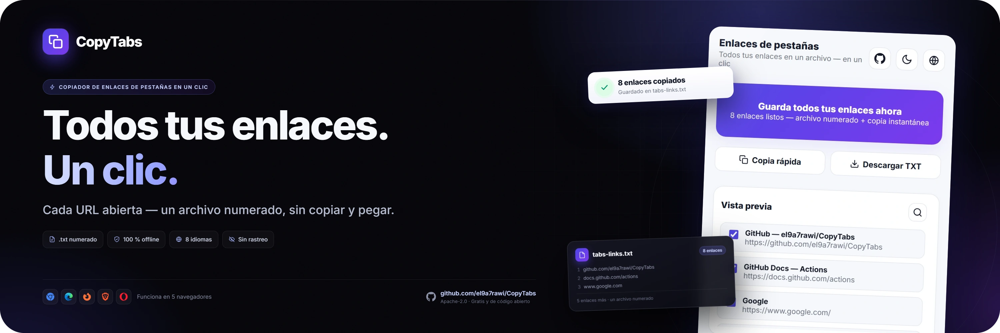
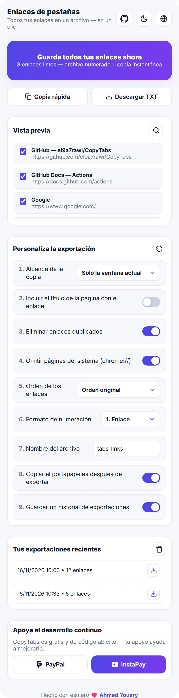
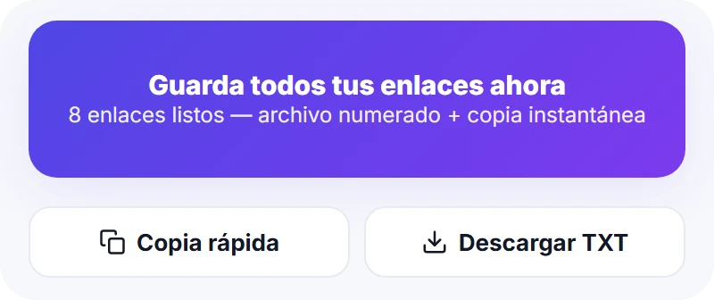
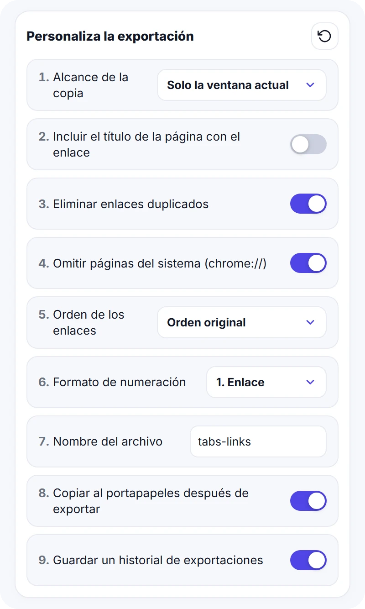

<p align="center">
  
</p>

<h1 align="center">CopyTabs — Copiador de enlaces de pestañas en un clic</h1>

<p align="center">¿Quince pestañas abiertas para una sola sesión de investigación? CopyTabs reúne cada URL abierta en un único archivo <code>.txt</code> numerado y en tu portapapeles con un clic — sin copiar y pegar a mano, y totalmente offline. La interfaz está en inglés por defecto, incluye ocho idiomas y se adapta por completo al árabe RTL.</p>

<p align="center">
  <a href="https://github.com/el9a7rawi/CopyTabs/releases"></a>
  <a href="https://github.com/el9a7rawi/CopyTabs/blob/main/LICENSE"></a>
  <a href="https://github.com/el9a7rawi/CopyTabs/pulls"></a>
  <a href="https://developer.chrome.com/docs/extensions"></a>
  
  
</p>

<p align="center">
  <sub><b>Languages:</b> <a href="README.md">English</a> · <a href="README.es.md"><b>Español</b></a> · <a href="README.fr.md">Français</a> · <a href="README.de.md">Deutsch</a> · <a href="README.pt-BR.md">Português (Brasil)</a> · <a href="README.ru.md">Русский</a> · <a href="README.ar.md">العربية</a> · <a href="README.zh-CN.md">中文（简体）</a></sub>
</p>

<p align="center">
  
</p>

<h3 align="center">Descárgalo para tu navegador — haz clic en el icono</h3>

<div align="center">

| [<br><b>Chrome</b>](https://github.com/el9a7rawi/CopyTabs/releases/latest) | [<br><b>Edge</b>](https://github.com/el9a7rawi/CopyTabs/releases/latest) | [<br><b>Firefox</b>](https://github.com/el9a7rawi/CopyTabs/releases/latest) | [<br><b>Brave</b>](https://github.com/el9a7rawi/CopyTabs/releases/latest) | [<br><b>Opera</b>](https://github.com/el9a7rawi/CopyTabs/releases/latest) |
|---|---|---|---|---|

</div>

<p align="center">
  
</p>

---

## 1. ¿Por qué CopyTabs?

<div align="center">

| Sin CopyTabs | Con CopyTabs |
|---|---|
| Copias cada URL a mano y la pegas en un archivo | Un clic reúne todos los enlaces, ya numerados |
| Una sesión de investigación se pierde al cerrar el navegador | Un archivo guardado, una copia en el portapapeles y un historial |
| Enlaces duplicados y páginas internas que no querías | Duplicados eliminados y páginas del sistema omitidas |

</div>

<div dir="ltr">

```text
1. https://www.google.com/
2. https://developer.chrome.com/docs/extensions/
3. https://github.com/
```

</div>

---

## 2. Cómo funciona — tres pasos

1. **Abre** CopyTabs desde la barra de herramientas: todas las pestañas abiertas aparecen con un recuento en vivo en el texto del botón principal.
2. **Haz clic** en la acción principal, o revisa la vista previa y elige enlaces concretos con el interruptor de cada uno.
3. **Comparte** — el archivo `.txt` se descarga al instante, el mismo texto llega al portapapeles y queda una copia en el historial.

---

## 3. Un recorrido por la interfaz

### 3.1 Las tres acciones de exportación

<p align="center"></p>

- **Guarda todos tus enlaces ahora** — la acción principal: exporta los enlaces seleccionados, descarga el archivo y copia el texto al portapapeles con un clic, con un recuento en vivo debajo.
- **Copia rápida** — solo portapapeles, sin descargar archivo.
- **Descargar TXT** — solo archivo, sin escribir en el portapapeles.
- Una línea de estado bajo los botones confirma el éxito o explica el error — y desaparece por completo cuando no hay nada que contar.

### 3.2 Vista previa y búsqueda en vivo

- Cada enlace tiene su propia tarjeta: título, URL y un **interruptor independiente** — desmarcar un enlace lo excluye de la exportación.
- El icono de la lupa se expande en un campo de búsqueda con una transición suave y filtra la vista previa **mientras escribes**, por título o URL.
- La **×** centrada borra el texto y deja la barra abierta; ciérrala con el icono otra vez o con `Escape`.
- Las URL se muestran de izquierda a derecha para que nunca se rompan dentro de la interfaz.

### 3.3 Personaliza la exportación

<p align="center"></p>

- **Tres menús desplegables propios** (no los del sistema): alcance, orden y formato de numeración — todos accesibles con teclado y lector de pantalla.
- **Interruptores**: incluir títulos, eliminar duplicados, omitir páginas del sistema, copiar al portapapeles e historial.
- **Campo de nombre de archivo** (hasta 60 caracteres, con limpieza automática de caracteres no válidos y sello de fecha).
- El **botón de restablecer** (flecha circular arriba de la sección) devuelve cada opción a su valor por defecto.
- La lista completa está en la sección 5.

### 3.4 Tus exportaciones recientes

- Las últimas **10 exportaciones**: fecha, hora y número de enlaces de cada una.
- Un botón de **descarga** por copia guardada y un botón de **borrar historial** (papelera) arriba.
- Un estado vacío amable antes de la primera exportación — tu primera ejecución aparece aquí al terminar.

### 3.5 Tema oscuro negro real

Fondo negro auténtico (`#000000`) con contraste ajustado, activado con el icono sol/luna de la cabecera y recordado automáticamente.

### 3.6 Menús con diseño propio

Nada de menús de Windows: alcance, orden y numeración son paneles flotantes limpios con marca de verificación, soporte completo de teclado y etiquetas para lectores de pantalla.

### 3.7 Apoya el desarrollo continuo

- Una sección opcional para quien quiera respaldar el proyecto — CopyTabs sigue siendo gratis y de código abierto.
- Un botón InstaPay destacado con PayPal como alternativa — ambos abren en una pestaña nueva y la extensión no envía datos.

---

## 4. Ocho idiomas — inglés primero y RTL bien hecho

- **El inglés es el idioma por defecto.** En el primer arranque CopyTabs sigue el idioma del navegador si es uno de los ocho, y después recuerda tu elección para siempre.
- **Cambia al instante** desde el icono del globo en la cabecera — sin recargar ni reiniciar. La elección se guarda en el mismo objeto de ajustes que el resto de opciones.
- **Ocho diccionarios completos**: English, Español, Français, Deutsch, Português (Brasil), Русский, العربية y 中文（简体）. Todo está traducido — botones, opciones, mensajes de estado e historial; nada vuelve al inglés a mitad de pantalla.
- **RTL de verdad, no un espejo superficial.** Al elegir العربية cambia la dirección lógica del documento: cabecera, búsqueda, menús, iconos e interruptores se colocan en su lado correcto, y las URL siguen de izquierda a derecha dentro de sus tarjetas.
- **Plurales reales.** Los recuentos usan `Intl.PluralRules`: el árabe recibe sus seis formas, el ruso sus cuatro y el chino su forma única — sin «1 links» en ninguna parte.
- **Totalmente offline.** Cada diccionario viaja dentro de la extensión; cambiar de idioma no hace ninguna petición de red.
- **Cada idioma tiene su propio README** con capturas de su interfaz — usa el selector de idioma de arriba.

---

## 5. Diez controles que dan forma a cada exportación

1. **Alcance** — solo la ventana actual o todas las ventanas.
2. **Incluir títulos** — líneas con el formato `1. Título — URL`.
3. **Eliminar enlaces duplicados** — se aplica antes de exportar.
4. **Omitir páginas del sistema** — ignora las páginas internas de tu navegador (`chrome://`, `edge://`, `about:` y similares).
5. **Orden** — orden original, alfabético o por dominio.
6. **Formato de numeración** — `1.`, `1)` o `-`.
7. **Nombre de archivo** — con sello de fecha automático: `tabs-links-YYYY-MM-DD.txt`.
8. **Copia automática al portapapeles** — después de cada exportación.
9. **Tema oscuro** — el botón sol/luna de la cabecera, recordado automáticamente.
10. **Historial** — las últimas 10 ejecuciones, con nueva descarga y borrado.

Además: búsqueda en vivo, interruptor por enlace, una insignia con el recuento en la barra de herramientas, menú contextual, dos atajos de teclado y un botón de restablecer.

---

## 6. Ejemplos del archivo exportado

Sin títulos:

<div dir="ltr">

```text
1. https://www.google.com/
2. https://developer.chrome.com/docs/extensions/
3. https://github.com/
```

</div>

Con **incluir títulos** activado:

<div dir="ltr">

```text
1. Google — https://www.google.com/
2. Chrome Extensions — https://developer.chrome.com/docs/extensions/
```

</div>

---

## 7. Instalación — un minuto

Abre la página de [Releases](https://github.com/el9a7rawi/CopyTabs/releases) y descarga la última compilación — **un archivo por navegador**: Chrome, Edge, Brave, Opera y Firefox (los cuatro de Chromium son idénticos; el de Firefox incluye la configuración de Gecko).

**Chrome / Edge / Brave / Opera** (archivo `copytabs-<browser>-vX.Y.Z.zip`, por ejemplo `copytabs-edge-v1.3.0.zip`):

1. Descomprime el archivo.
2. Abre `chrome://extensions` (o la página equivalente) y activa el **modo desarrollador**.
3. Elige **Cargar descomprimida**, selecciona la carpeta y fija el icono en la barra.

**Firefox** (archivo `copytabs-firefox-vX.Y.Z.zip`):

1. Descomprime el archivo.
2. Abre `about:debugging` → This Firefox → Load Temporary Add-on → selecciona `manifest.json`.
3. La compilación firmada estará siempre en la página de AMO (próximamente).

**Para desarrolladores desde el código:** haz `git clone` y carga la carpeta como extensión descomprimida en navegadores Chromium; para Firefox usa la salida de `python tools/build.py` — el manifest fuente va sin `background.scripts` (necesario para Chrome).

> Sin paso de compilación ni dependencias — cada cambio solo necesita **Reload** en la página de extensiones. Requisitos: Chrome / Edge / Brave / Opera / Firefox 121 o superior.

---

## 8. La privacidad primero

<div align="center">

| Principio | Cómo se aplica |
|---|---|
| Funciona totalmente offline | Cero peticiones de red |
| Mínimos permisos | Solo `tabs`, `storage`, `contextMenus` y `downloads` |
| Tus datos se quedan en tu equipo | Ajustes e historial en `storage.local` — ningún enlace se envía a un servidor |

</div>

---

## 9. Preguntas frecuentes

**9.1 ¿Funciona sin conexión?**
Sí, por completo; el único recurso remoto son las hojas de estilo de las fuentes Inter y Cairo de Google Fonts, y la extensión vuelve a fuentes locales si no están disponibles. Cada diccionario está incluido localmente.

**9.2 ¿Se recogen mis datos?**
No. La extensión no contiene ningún código de red — puedes comprobarlo tú mismo en el código fuente.

**9.3 ¿Cómo cambio el formato de numeración?**
Abre *Personaliza la exportación → Formato de numeración*: `1.`, `1)` o `-`.

**9.4 ¿Por qué falta una pestaña en mi exportación?**
Comprueba que sigue marcada en la vista previa, que no es una página del sistema que decidiste omitir y que no se eliminó como duplicada.

**9.5 ¿Cómo cambio el idioma de la interfaz?**
Haz clic en el globo de la cabecera y elige un idioma. El inglés es el predeterminado; el primer arranque sigue el idioma del navegador si está disponible y tu elección se recuerda después.

---

## 10. Para desarrolladores

<div dir="ltr">

```text
├── manifest.json      ← single source MV3 manifest (the build emits one variant per browser)
├── popup.html/css/js  ← the interface (Inter first, Cairo/Tajawal for Arabic, logical RTL)
├── i18n.js            ← locale loader, plural rules, direction switching
├── browser.js         ← host browser detection + shared system-page prefixes
├── locales/           ← eight complete dictionaries (en, es, fr, de, pt-BR, ru, ar, zh-CN)
├── background.js      ← one shared background: service_worker, emitted as scripts for Firefox
├── icons/             ← 16 / 32 / 48 / 128
├── assets/            ← README screenshots (one folder per language) + browser icons
├── tools/build.py     ← store builds + SHA256 (used by CI and releases)
├── tools/check_locales.py ← key parity, plural categories, placeholder validation
└── tools/screenshots.py   ← regenerates every README screenshot from the real popup
```

</div>

Inglés por defecto con ocho locales incluidos y diseño RTL lógico, `textContent` solo al mostrar datos (nunca `innerHTML`) y ajustes en `chrome.storage.local`. Verificación rápida:

<div dir="ltr">

```powershell
python3 -c "import json; json.load(open('manifest.json')); print('manifest OK')"
python3 tools/check_locales.py
```

</div>

---

## 11. Licencia y contribuciones

El proyecto es de código abierto y gratuito para todos bajo la licencia **Apache-2.0** — úsalo, modifícalo y compártelo libremente; el texto completo está en [LICENSE](LICENSE).

Las contribuciones son bienvenidas: abre un issue para errores e ideas, o envía un pull request directamente — la CI valida el manifest y cada enlace de imagen antes de fusionar.

---

<p align="center">Hecho con esmero por <b>Ahmed Yousry</b> · <a href="LICENSE">Apache-2.0</a></p>
