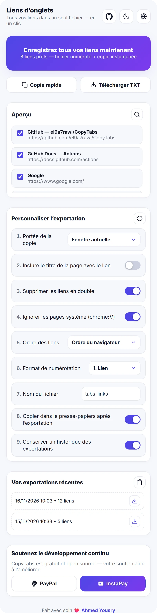
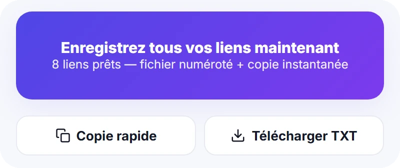
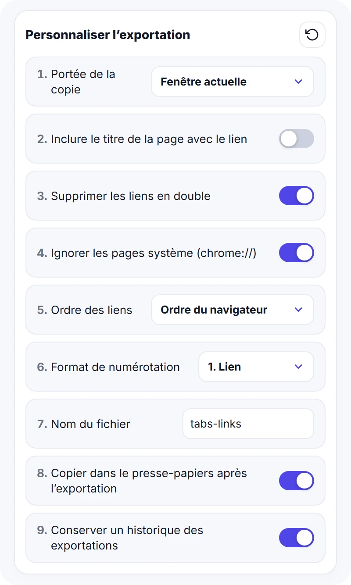

<p align="center">
  
</p>

<h1 align="center">CopyTabs — Copieur de liens d’onglets en un clic</h1>

<p align="center">Quinze onglets ouverts pour une seule session de recherche ? CopyTabs rassemble chaque URL ouverte dans un unique fichier <code>.txt</code> numéroté et dans votre presse-papiers en un clic — sans copier-coller manuel, et entièrement hors ligne. L’interface est en anglais par défaut, propose huit langues et s’adapte entièrement à l’arabe RTL.</p>

<p align="center">
  <a href="https://github.com/el9a7rawi/CopyTabs/releases"></a>
  <a href="https://github.com/el9a7rawi/CopyTabs/blob/main/LICENSE"></a>
  <a href="https://github.com/el9a7rawi/CopyTabs/pulls"></a>
  <a href="https://developer.chrome.com/docs/extensions"></a>
  
  
</p>

<p align="center">
  <sub><b>Languages:</b> <a href="README.md">English</a> · <a href="README.es.md">Español</a> · <a href="README.fr.md"><b>Français</b></a> · <a href="README.de.md">Deutsch</a> · <a href="README.pt-BR.md">Português (Brasil)</a> · <a href="README.ru.md">Русский</a> · <a href="README.ar.md">العربية</a> · <a href="README.zh-CN.md">中文（简体）</a></sub>
</p>

<p align="center">
  
</p>

<h3 align="center">Téléchargez pour votre navigateur — cliquez sur l’icône</h3>

<div align="center">

| [<br><b>Chrome</b>](https://github.com/el9a7rawi/CopyTabs/releases/latest) | [<br><b>Edge</b>](https://github.com/el9a7rawi/CopyTabs/releases/latest) | [<br><b>Firefox</b>](https://github.com/el9a7rawi/CopyTabs/releases/latest) | [<br><b>Brave</b>](https://github.com/el9a7rawi/CopyTabs/releases/latest) | [<br><b>Opera</b>](https://github.com/el9a7rawi/CopyTabs/releases/latest) |
|---|---|---|---|---|

</div>

<p align="center">
  
</p>

---

## 1. Pourquoi CopyTabs ?

<div align="center">

| Sans CopyTabs | Avec CopyTabs |
|---|---|
| Copier chaque URL à la main et la coller dans un fichier | Un clic rassemble tous les liens, déjà numérotés |
| Une session de recherche perdue à la fermeture du navigateur | Un fichier enregistré, une copie dans le presse-papiers et un historique |
| Des liens en double et des pages internes inutiles | Doublons supprimés et pages système ignorées |

</div>

<div dir="ltr">

```text
1. https://www.google.com/
2. https://developer.chrome.com/docs/extensions/
3. https://github.com/
```

</div>

---

## 2. Comment ça marche — trois étapes

1. **Ouvrez** CopyTabs depuis la barre d’outils : chaque onglet ouvert est listé avec un compteur en direct dans le texte du bouton principal.
2. **Cliquez** sur l’action principale, ou parcourez l’aperçu et choisissez des liens précis avec l’interrupteur de chaque ligne.
3. **Partagez** — le fichier `.txt` se télécharge aussitôt, le même texte arrive dans le presse-papiers et une copie reste dans l’historique.

---

## 3. Visite de l’interface

### 3.1 Les trois actions d’exportation

<p align="center"></p>

- **Enregistrez tous vos liens maintenant** — l’action principale : exporte les liens sélectionnés, télécharge le fichier et copie le texte dans le presse-papiers en un clic, avec un compteur en direct en dessous.
- **Copie rapide** — presse-papiers uniquement, sans fichier.
- **Télécharger TXT** — fichier uniquement, sans écrire dans le presse-papiers.
- Une ligne d’état sous les boutons confirme le succès ou explique l’erreur — et disparaît complètement quand il n’y a rien à dire.

### 3.2 Aperçu et recherche en direct

- Chaque lien a sa carte : titre, URL et un **interrupteur dédié** — décocher un lien le retire de l’exportation.
- L’icône de loupe s’étend en champ de recherche avec une transition douce et filtre l’aperçu **pendant la frappe**, par titre ou URL.
- La **×** centrée efface le texte en gardant la barre ouverte ; refermez-la avec l’icône ou `Échap`.
- Les URL s’affichent de gauche à droite pour ne jamais se couper dans l’interface.

### 3.3 Personnaliser l’exportation

<p align="center"></p>

- **Trois menus déroulants maison** (pas ceux du système) : portée, ordre et format de numérotation — tous accessibles au clavier et au lecteur d’écran.
- **Interrupteurs** : inclure les titres, supprimer les doublons, ignorer les pages système, copie automatique et historique.
- **Champ du nom de fichier** (60 caractères maximum, nettoyage automatique des caractères invalides et date ajoutée).
- Le **bouton de réinitialisation** (flèche circulaire en haut de la section) rétablit chaque option par défaut.
- La liste complète figure à la section 5.

### 3.4 Vos exportations récentes

- Les **10 dernières exportations** : date, heure et nombre de liens.
- Un bouton de **téléchargement** pour chaque copie et un bouton **effacer l’historique** (corbeille) en haut.
- Un état vide accueillant avant la première exportation — elle apparaît ici dès qu’elle se termine.

### 3.5 Un vrai thème sombre noir

Fond noir véritable (`#000000`) au contraste ajusté, basculé par l’icône soleil/lune de l’en-tête et mémorisé automatiquement.

### 3.6 Des menus au design propre

Fini les menus Windows : portée, ordre et numérotation sont des panneaux flottants soignés avec coche, navigation clavier complète et libellés pour lecteurs d’écran.

### 3.7 Soutenez le développement continu

- Une section facultative pour ceux qui veulent soutenir le projet — CopyTabs reste gratuit et open source.
- Un bouton InstaPay mis en avant, PayPal en alternative — les deux s’ouvrent dans un nouvel onglet et l’extension n’envoie aucune donnée.

---

## 4. Huit langues — l’anglais d’abord, le RTL bien fait

- **L’anglais est la langue par défaut.** Au premier lancement, CopyTabs suit la langue du navigateur si elle fait partie des huit, puis mémorise votre choix définitif.
- **Changez instantanément** depuis l’icône globe de l’en-tête — sans rechargement ni redémarrage. Le choix est stocké avec les autres options.
- **Huit dictionnaires complets** : English, Español, Français, Deutsch, Português (Brasil), Русский, العربية et 中文（简体）. Tout est traduit — boutons, options, messages et historique ; rien ne retombe en anglais au milieu de l’écran.
- **Un vrai RTL, pas un miroir superficiel.** Choisir العربية inverse logiquement le document : en-tête, recherche, menus, icônes et interrupteurs passent du bon côté, et les URL restent de gauche à droite dans leurs cartes.
- **Pluriels réels.** Les compteurs utilisent `Intl.PluralRules` : l’arabe obtient ses six formes, le russe ses quatre et le chinois sa forme unique — jamais de « 1 liens ».
- **Entièrement hors ligne.** Chaque dictionnaire est embarqué ; changer de langue ne fait aucune requête réseau.
- **Chaque langue a son propre README** avec ses captures — utilisez le sélecteur en haut de page.

---

## 5. Dix réglages qui façonnent chaque exportation

1. **Portée** — fenêtre actuelle uniquement, ou toutes les fenêtres.
2. **Inclure les titres** — lignes au format `1. Titre — URL`.
3. **Supprimer les doublons** — appliqué automatiquement avant l’export.
4. **Ignorer les pages système** — ignore les pages internes de votre navigateur (`chrome://`, `edge://`, `about:` et similaires).
5. **Ordre** — ordre d’origine, alphabétique ou par domaine.
6. **Format de numérotation** — `1.`, `1)` ou `-`.
7. **Nom de fichier** — avec date automatique : `tabs-links-YYYY-MM-DD.txt`.
8. **Copie automatique** — dans le presse-papiers après chaque export.
9. **Thème sombre** — le bouton soleil/lune de l’en-tête, mémorisé.
10. **Historique** — les 10 dernières exportations, avec retéléchargement et effacement.

En plus : recherche en direct, interrupteur par lien, un badge de compteur dans la barre d’outils, menu contextuel, deux raccourcis clavier et un bouton de réinitialisation.

---

## 6. Exemples de fichier exporté

Sans titres :

<div dir="ltr">

```text
1. https://www.google.com/
2. https://developer.chrome.com/docs/extensions/
3. https://github.com/
```

</div>

Avec **inclure les titres** activé :

<div dir="ltr">

```text
1. Google — https://www.google.com/
2. Chrome Extensions — https://developer.chrome.com/docs/extensions/
```

</div>

---

## 7. Installation — une minute

Ouvrez la page des [Releases](https://github.com/el9a7rawi/CopyTabs/releases) et téléchargez la dernière compilation — **une archive par navigateur** : Chrome, Edge, Brave, Opera et Firefox (les quatre archives Chromium sont identiques ; celle de Firefox contient les réglages Gecko).

**Chrome / Edge / Brave / Opera** (fichier `copytabs-<browser>-vX.Y.Z.zip`, par exemple `copytabs-edge-v1.3.0.zip`) :

1. Décompressez l’archive.
2. Ouvrez `chrome://extensions` (ou la page équivalente) et activez le **mode développeur**.
3. Choisissez **Charger l’extension non empaquetée**, sélectionnez le dossier, puis épinglez l’icône.

**Firefox** (fichier `copytabs-firefox-vX.Y.Z.zip`) :

1. Décompressez l’archive.
2. Ouvrez `about:debugging` → This Firefox → Load Temporary Add-on → sélectionnez `manifest.json`.
3. La version signée reste disponible sur la page AMO (bientôt).

**Pour les développeurs depuis les sources :** `git clone` le dépôt, puis chargez le dossier comme extension non empaquetée dans les navigateurs Chromium ; pour Firefox utilisez la sortie de `python tools/build.py` — le manifest source n’a pas `background.scripts` (requis pour Chrome).

> Aucune étape de build, aucune dépendance — chaque modification demande seulement **Reload** dans la page des extensions. Prérequis : Chrome / Edge / Brave / Opera / Firefox 121 ou plus.

---

## 8. La confidentialité d’abord

<div align="center">

| Principe | Application |
|---|---|
| Fonctionne entièrement hors ligne | Zéro requête réseau |
| Permissions minimales | Uniquement `tabs`, `storage`, `contextMenus` et `downloads` |
| Vos données restent chez vous | Réglages et historique dans `storage.local` — aucun lien envoyé à un serveur |

</div>

---

## 9. Questions fréquentes

**9.1 Fonctionne-t-il sans connexion ?**
Oui, entièrement ; la seule ressource distante est la feuille de style des polices Inter et Cairo de Google Fonts, et l’extension revient aux polices locales si elle est inaccessible. Chaque dictionnaire est embarqué.

**9.2 Mes données sont-elles collectées ?**
Non. L’extension ne contient aucun code réseau — vous pouvez le vérifier vous-même dans les sources.

**9.3 Comment changer le format de numérotation ?**
Ouvrez *Personnaliser l’exportation → Format de numérotation* : `1.`, `1)` ou `-`.

**9.4 Pourquoi un onglet manque-t-il à l’export ?**
Vérifiez qu’il est toujours coché dans l’aperçu, qu’il n’est pas une page système ignorée et qu’il n’a pas été retiré comme doublon.

**9.5 Comment changer la langue de l’interface ?**
Cliquez sur le globe de l’en-tête et choisissez une langue. L’anglais est par défaut ; le premier lancement suit la langue du navigateur si elle est prise en charge, puis votre choix est mémorisé.

---

## 10. Pour les développeurs

<div dir="ltr">

```text
├── manifest.json      ← single source MV3 manifest (the build emits one variant per browser)
├── popup.html/css/js  ← the interface (Inter first, Cairo/Tajawal for Arabic, logical RTL)
├── i18n.js            ← locale loader, plural rules, direction switching
├── browser.js         ← host browser detection + shared system-page prefixes
├── locales/           ← eight complete dictionaries (en, es, fr, de, pt-BR, ru, ar, zh-CN)
├── background.js      ← one shared background: service_worker, emitted as scripts for Firefox
├── icons/             ← 16 / 32 / 48 / 128
├── assets/            ← README screenshots (one folder per language) + browser icons
├── tools/build.py     ← store builds + SHA256 (used by CI and releases)
├── tools/check_locales.py ← key parity, plural categories, placeholder validation
└── tools/screenshots.py   ← regenerates every README screenshot from the real popup
```

</div>

Anglais par défaut avec huit locales embarquées et une mise en page RTL logique, `textContent` uniquement pour afficher des données (jamais `innerHTML`), et réglages dans `chrome.storage.local`. Vérification rapide :

<div dir="ltr">

```powershell
python3 -c "import json; json.load(open('manifest.json')); print('manifest OK')"
python3 tools/check_locales.py
```

</div>

---

## 11. Licence et contributions

Le projet est open source et gratuit pour tous sous licence **Apache-2.0** — utilisez-le, modifiez-le et partagez-le librement ; le texte complet est dans [LICENSE](LICENSE).

Les contributions sont bienvenues : ouvrez une issue pour un bug ou une idée, ou envoyez directement une pull request — la CI valide le manifest et chaque lien d’image avant la fusion.

---

<p align="center">Fait avec soin par <b>Ahmed Yousry</b> · <a href="LICENSE">Apache-2.0</a></p>
