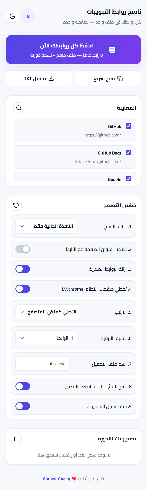
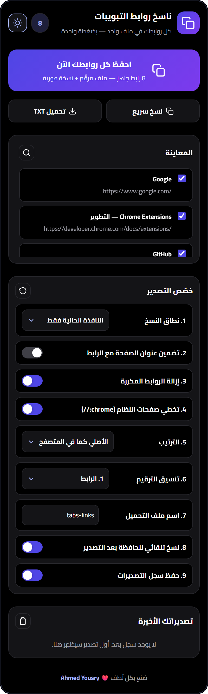
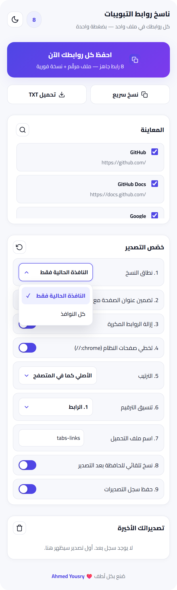
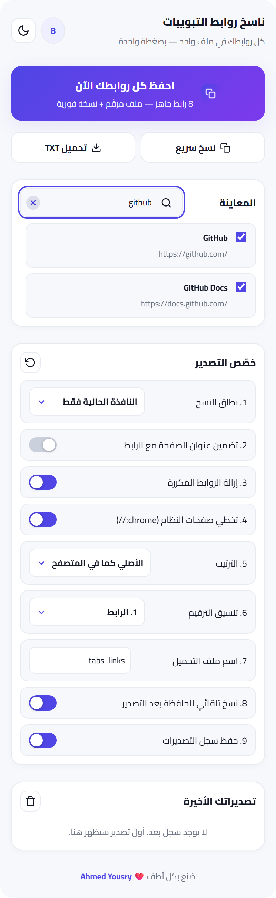
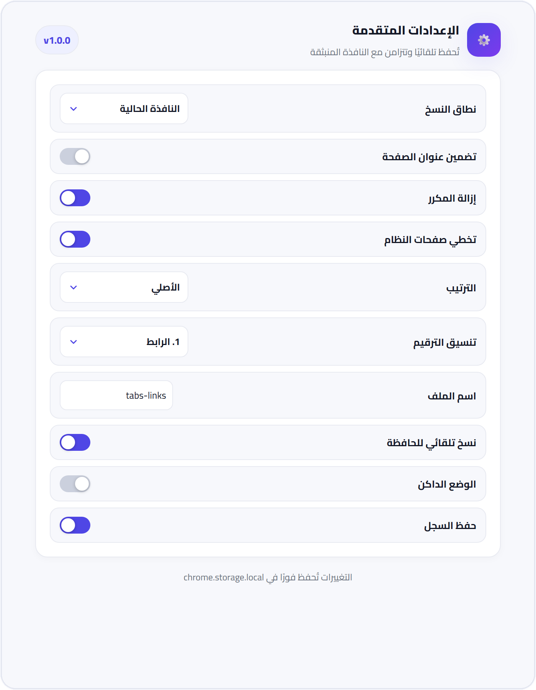

<div dir="rtl">

<p align="center">
  
</p>

<h1 align="center">CopyTabs — كل روابط تبويباتك في ملف واحد، بضغطة واحدة</h1>

<p align="center">فاتح 15 تبويبًا للبحث؟ مجمّع شروحات؟ تراجع منافسين؟ بدل النسخ اليدوي رابطًا رابطًا — <b>اضغط زرًا واحدًا</b> واحصل على ملف <code>.txt</code> مرقّم وجاهز للمشاركة، <b>ونسخة فورية في حافظتك</b>.</p>

<p align="center">
  
  
  
  
  
</p>

<p align="center">
  
  
</p>

---

## 1. لماذا CopyTabs؟

| بدون CopyTabs | مع CopyTabs |
|---|---|
| نسخ كل رابط يدويًا ولصقه في ملف | ضغطة واحدة تجمع كل الروابط مرقّمة |
| جلسة بحث كاملة تضيع بإغلاق المتصفح | ملف محفوظ + نسخة في الحافظة + سجل تصديرات |
| روابط مكررة وصفحات نظام لا تريدها | إزالة المكرر وتخطي صفحات النظام تلقائيًا |

```text
1. https://www.google.com/
2. https://developer.chrome.com/docs/extensions/
3. https://github.com/
```

---

## 2. كيف يعمل؟ (3 خطوات فقط)

1. **افتح** الإضافة من شريط كروم — ستجد كل تبويباتك معروضة أمامك مع عدّاد حي.
2. **اضغط** «احفظ كل روابطك الآن» — أو راجع المعاينة وحدّد ما تريد بزر لكل رابط.
3. **شارك** — ملف `.txt` يُحمَّل فورًا، والنص نفسه في حافظتك، ونسخة محفوظة في سجل تصديراتك.

---

## 3. جولة مصورة في الواجهة

### 3.1 زر واحد ينجز كل شيء

<p align="center"></p>

الزر الرئيسي يصدّر ويحمّل وينسخ في خطوة واحدة، وتحته زرّا «نسخ سريع» و«تحميل TXT» — مع عدّاد حي بعدد الروابط الجاهزة ومعاينة لكل رابط قبل التصدير.

### 3.2 أسود حقيقي مريح للعين

<p align="center"></p>

وضع داكن بخلفية سوداء فعلية وتباين محسوب، يُبدَّل بأيقونة شمس/قمر في الهيدر ويُحفَظ تلقائيًا.

### 3.3 قوائم بتصميم خاص

<p align="center"></p>

لا قوائم ويندوز افتراضية: النطاق والترتيب والترقيم نوافذ عائمة أنيقة بعلامة تحديد ودعم كامل للوحة المفاتيح وقارئ الشاشة.

### 3.4 بحث يظهر عند الحاجة

<p align="center"></p>

أيقونة عدسة تتوسع منها خانة البحث بحركة ناعمة، تُرشّح المعاينة لحظيًا — مع زر مسح متمركز يبقي الشريط مفتوحًا.

### 3.5 الإعدادات على الشاشات الكبيرة

<p align="center"></p>

صفحة إعدادات بنفس الخيارات وحفظ فوري، تُفتَح من تفاصيل الإضافة.

---

## 4. عشر مميزات تتحكم في كل التفاصيل

1. **نطاق النسخ** — النافذة الحالية فقط، أو كل النوافذ.
2. **تضمين عنوان الصفحة** — سطر بصيغة `1. العنوان — الرابط`.
3. **إزالة الروابط المكررة** — تلقائيًا قبل التصدير.
4. **تخطي صفحات النظام** — يتجاهل `chrome://` وما شابهها.
5. **الترتيب** — الأصلي كما في المتصفح، أو أبجدي، أو حسب الدومين.
6. **تنسيق الترقيم** — `1.` أو `1)` أو `-`.
7. **اسم ملف مخصص** — مع ختم تاريخ تلقائي `tabs-links-YYYY-MM-DD.txt`.
8. **نسخ تلقائي للحافظة** — بعد كل تصدير.
9. **الوضع الداكن** — زر شمس/قمر في الهيدر يُحفظ تلقائيًا.
10. **سجل آخر 10 تصديرات** — مع إعادة تحميل أي نسخة ومسح السجل.

وفوقها: بحث حي، وتحديد فردي لكل رابط، وعدّاد وشارة بعدد الروابط، وقائمة سياق (كليك يمين)، واختصاران للوحة المفاتيح، وزر إعادة ضبط.

---

## 5. مثال ملف التصدير

بدون عناوين:

```text
1. https://www.google.com/
2. https://developer.chrome.com/docs/extensions/
3. https://github.com/
```

مع تفعيل «تضمين عنوان الصفحة»:

```text
1. Google — https://www.google.com/
2. Chrome Extensions — https://developer.chrome.com/docs/extensions/
```

---

## 6. التثبيت على كروم (دقيقة واحدة)

1. حمّل الريبو (**Code ← Download ZIP** وفك الضغط، أو `git clone`).
2. افتح `chrome://extensions` وفعّل **Developer mode**.
3. اختر **Load unpacked** وحدّد مجلد المشروع، ثم ثبّت الأيقونة 📌.

> لا build ولا اعتماديات — أي تعديل على الكود يلزمه **Reload** من صفحة الإضافات فقط.

---

## 7. خصوصيتك أولًا

- يعمل أوفلاين بالكامل — صفر طلبات شبكة.
- أقل صلاحيات ممكنة: `tabs` و`storage` و`contextMenus` و`downloads`.
- الإعدادات والسجل محفوظة محليًا على جهازك فقط — لا يُرسَل أي رابط لأي سيرفر.

---

## 8. أسئلة شائعة

**هل يعمل بدون إنترنت؟**
نعم بالكامل؛ فقط خط Cairo يُحمَّل من جوجل وله بديل تلقائي عند الانقطاع.

**هل تُجمَع بياناتي؟**
لا — لا يوجد أي كود شبكة في الإضافة، وراجع الكود بنفسك.

**أريد صيغة ترقيم مختلفة؟**
من «خصّص التصدير ← تنسيق الترقيم»: `1.` أو `1)` أو `-`.

**التصدير لا يشمل تبويبًا معينًا؟**
تأكد أنه محدد في المعاينة، وأنه ليس صفحة نظام مستثناة، وأنه ليس مكررًا محذوفًا.

---

## 9. للمطورين

```text
├── manifest.json      ← إعلان Manifest V3
├── popup.html/css/js  ← الواجهة (Cairo + Tajawal)
├── background.js      ← Service Worker (شارة العدد + تصدير سريع)
├── options.html/js    ← مرآة الإعدادات
└── icons/             ← 16 / 32 / 48 / 128
```

واجهة عربية RTL كاملة، `textContent` فقط لعرض البيانات (لا `innerHTML`)، والإعدادات في `chrome.storage.local` — والتحقق السريع:

```powershell
python3 -c "import json; json.load(open('manifest.json')); print('manifest OK')"
```

---

<p align="center">صُنع بكل لُطف ❤️ <b>Ahmed Yousry</b></p>
<p align="center"><i>وفّرت عليك وقت؟ ⭐ على الريبو تساعد غيرك يوصلها.</i></p>

</div>
