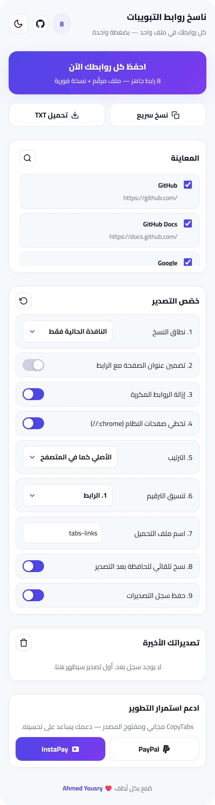
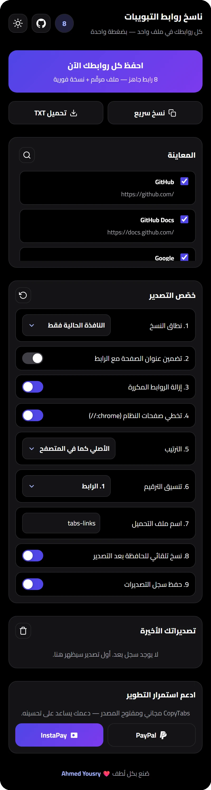
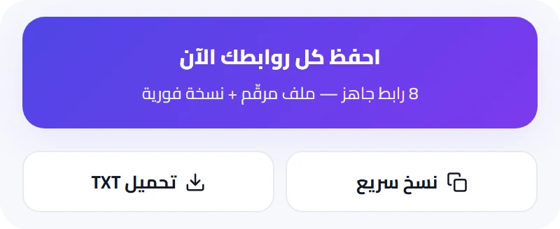
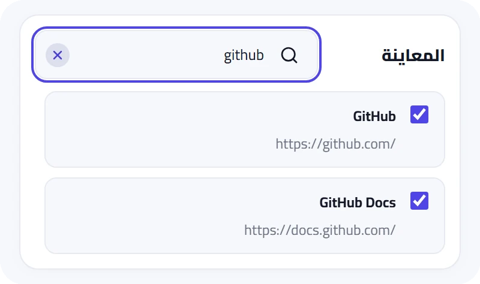
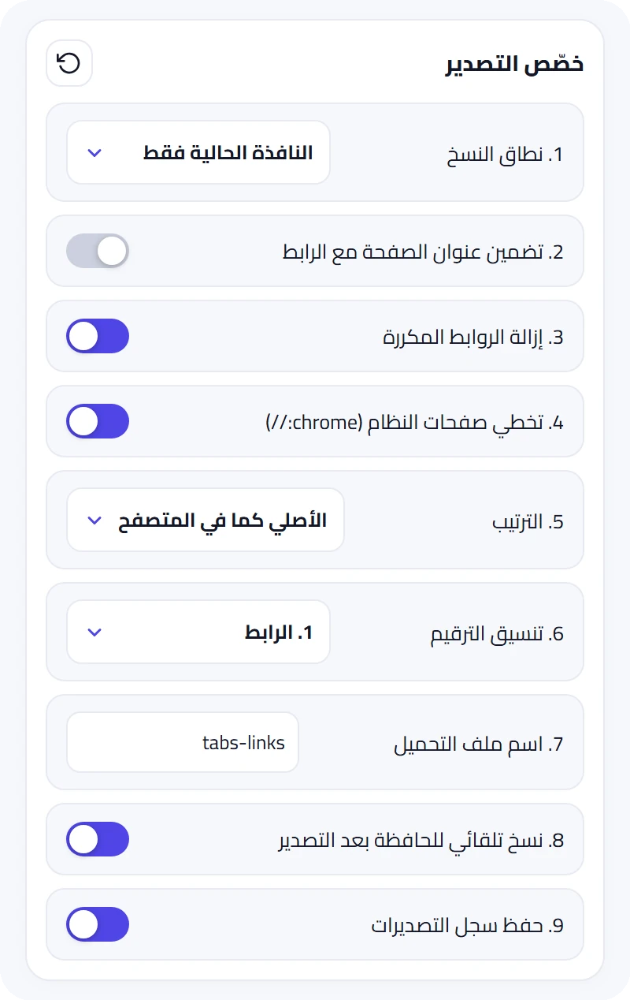
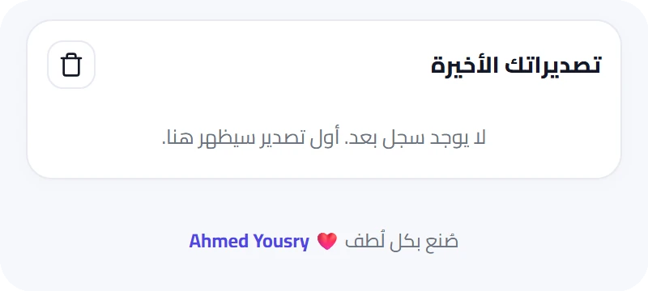
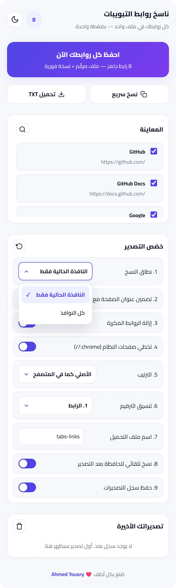
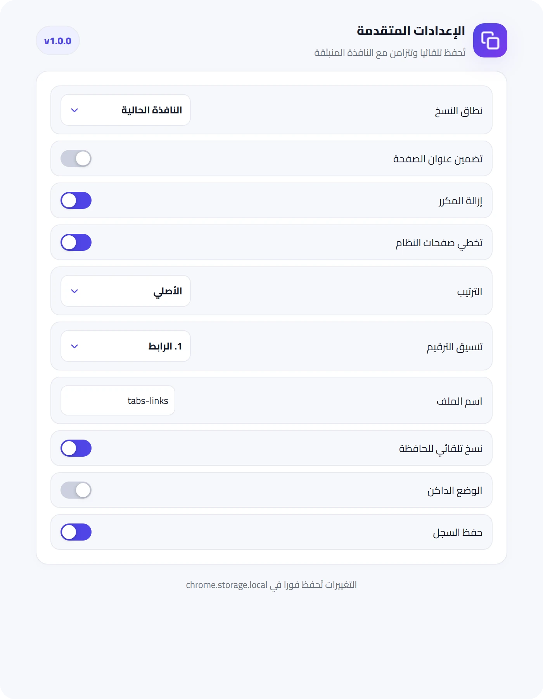

<div dir="rtl">

<p align="center">
  
</p>

<h1 align="center">CopyTabs — كل روابط تبويباتك في ملف واحد، بضغطة واحدة</h1>

<p align="center">فاتح 15 تبويبًا للبحث؟ مجمّع شروحات؟ تراجع منافسين؟ بدل النسخ اليدوي رابطًا رابطًا — <b>اضغط زرًا واحدًا</b> واحصل على ملف <code>.txt</code> مرقّم وجاهز للمشاركة، <b>ونسخة فورية في حافظتك</b>.</p>

<p align="center">
  
  
  
  
  
  
  <a href="https://github.com/el9a7rawi/CopyTabs/releases"></a>
</p>

<p align="center">
  
  
</p>

---

## 1. لماذا CopyTabs؟

<div align="center">

| بدون CopyTabs | مع CopyTabs |
|---|---|
| نسخ كل رابط يدويًا ولصقه في ملف | ضغطة واحدة تجمع كل الروابط مرقّمة |
| جلسة بحث كاملة تضيع بإغلاق المتصفح | ملف محفوظ + نسخة في الحافظة + سجل تصديرات |
| روابط مكررة وصفحات نظام لا تريدها | إزالة المكرر وتخطي صفحات النظام تلقائيًا |

</div>

<div dir="ltr">

```text
1. https://www.google.com/
2. https://developer.chrome.com/docs/extensions/
3. https://github.com/
```

</div>

---

## 2. كيف يعمل؟ (3 خطوات فقط)

1. **افتح** الإضافة من شريط كروم — ستجد كل تبويباتك معروضة أمامك مع عدّاد حي.
2. **اضغط** «احفظ كل روابطك الآن» — أو راجع المعاينة وحدّد ما تريد بزر لكل رابط.
3. **شارك** — ملف `.txt` يُحمَّل فورًا، والنص نفسه في حافظتك، ونسخة محفوظة في سجل تصديراتك.

---

## 3. تشريح الواجهة — كل جزء بالتفصيل

### 3.1 أزرار التصدير الثلاثة

<p align="center"></p>

- **«احفظ كل روابطك الآن»** — الزر الرئيسي: يصدّر الروابط المحددة، ويحمّل الملف، وينسخ النص للحافظة في ضغطة واحدة، وتحته سطر حي بعدد الروابط الجاهزة.
- **«نسخ سريع»** — نسخ للحافظة فقط دون تحميل ملف.
- **«تحميل TXT»** — تحميل الملف فقط دون نسخ.
- رسالة حالة تحت الأزرار تؤكد النجاح أو تشرح الخطأ — وتختفي تمامًا عند عدم الحاجة فلا تترك فراغًا.

### 3.2 المعاينة والبحث الحي

<p align="center"></p>

- كل رابط في بطاقة مستقلة: العنوان + الرابط + **زر تحديد خاص به** — إلغاء التحديد يسقطه من التصدير.
- أيقونة العدسة تتوسع منها خانة البحث بحركة ناعمة، وتُرشّح المعاينة **لحظيًا** بالعنوان أو الرابط.
- زر **×** متمركز يمسح النص مع بقاء الشريط مفتوحًا؛ والإغلاق الكامل بالعدسة مجددًا أو بزر `Escape`.
- الروابط تُعرض باتجاه يسار-ليمين حتى لا تنكسر داخل الواجهة العربية.

### 3.3 خصّص التصدير

<p align="center"></p>

- **3 قوائم مخصصة** بتصميم خاص (ليست قوائم الويندوز): النطاق، والترتيب، وتنسيق الترقيم — بدعم كامل للوحة المفاتيح وقارئ الشاشة.
- **مفاتيح تشغيل/إيقاف**: تضمين العناوين، إزالة المكرر، تخطي صفحات النظام، النسخ التلقائي، حفظ السجل.
- **حقل اسم الملف** (حتى 60 حرفًا، مع تنظيف تلقائي للرموز غير الصالحة وختم تاريخ تلقائي).
- زر **إعادة الضبط** (السهم الدائري أعلى القسم) يعيد كل الخيارات للوضع الافتراضي.
- القائمة الكاملة بكل خيار في قسم 4 بالأسفل.

### 3.4 تصديراتك الأخيرة

<p align="center"></p>

- آخر **10 تصديرات**: التاريخ والوقت + عدد الروابط لكل عملية.
- زر **تحميل** لكل نسخة محفوظة + زر **مسح السجل** (السلة) أعلى القسم.
- حالة فارغة لطيفة قبل أول تصدير — وأول عملية تظهر هنا فور إتمامها.

### 3.5 أسود حقيقي مريح للعين

<p align="center"></p>

وضع داكن بخلفية سوداء فعلية وتباين محسوب، يُبدَّل بأيقونة شمس/قمر في الهيدر ويُحفَظ تلقائيًا.

### 3.6 قوائم بتصميم خاص

<p align="center"></p>

لا قوائم ويندوز افتراضية: النطاق والترتيب والترقيم نوافذ عائمة أنيقة بعلامة تحديد ✓ ودعم كامل للوحة المفاتيح وقارئ الشاشة.

### 3.7 الإعدادات على الشاشات الكبيرة

<p align="center"></p>

صفحة إعدادات بنفس الخيارات وحفظ فوري، تُفتَح من تفاصيل الإضافة.

---

## 4. عشر مميزات تتحكم في كل التفاصيل

1. **نطاق النسخ** — النافذة الحالية فقط، أو كل النوافذ.
2. **تضمين عنوان الصفحة** — سطر بصيغة `1. العنوان — الرابط`.
3. **إزالة الروابط المكررة** — تلقائيًا قبل التصدير.
4. **تخطي صفحات النظام** — يتجاهل `chrome://` وما شابهها.
5. **الترتيب** — الأصلي كما في المتصفح، أو أبجدي، أو حسب الدومين.
6. **تنسيق الترقيم** — `1.` أو `1)` أو `-`.
7. **اسم ملف مخصص** — مع ختم تاريخ تلقائي `tabs-links-YYYY-MM-DD.txt`.
8. **نسخ تلقائي للحافظة** — بعد كل تصدير.
9. **الوضع الداكن** — زر شمس/قمر في الهيدر يُحفظ تلقائيًا.
10. **سجل آخر 10 تصديرات** — مع إعادة تحميل أي نسخة ومسح السجل.

وفوقها: بحث حي، وتحديد فردي لكل رابط، وعدّاد وشارة بعدد الروابط، وقائمة سياق (كليك يمين)، واختصاران للوحة المفاتيح، وزر إعادة ضبط.

---

## 5. مثال ملف التصدير

بدون عناوين:

<div dir="ltr">

```text
1. https://www.google.com/
2. https://developer.chrome.com/docs/extensions/
3. https://github.com/
```

</div>

مع تفعيل «تضمين عنوان الصفحة»:

<div dir="ltr">

```text
1. Google — https://www.google.com/
2. Chrome Extensions — https://developer.chrome.com/docs/extensions/
```

</div>

---

## 6. التثبيت (دقيقة واحدة)

من صفحة [Releases](https://github.com/el9a7rawi/CopyTabs/releases) حمّل النسخة الأخيرة — **ملف باسم كل متصفح**: Chrome وEdge وBrave وOpera وFirefox (ملفات Chromium الأربعة متطابقة المحتوى، وملف Firefox يحمل إعدادات Gecko).

**Chrome / Edge / Brave / Opera** (ملف `copytabs-<المتصفح>-vX.Y.Z.zip` — مثال: `copytabs-edge-v1.0.1.zip`):

1. فك ضغط الملف.
2. افتح `chrome://extensions` (أو ما يقابلها) وفعّل **Developer mode**.
3. اختر **Load unpacked** وحدّد المجلد المفكوك، ثم ثبّت الأيقونة 📌.

**Firefox** (ملف `copytabs-firefox-vX.Y.Z.zip`):

1. فك ضغط الملف.
2. افتح `about:debugging` ← ‏This Firefox ← ‏Load Temporary Add-on ← اختر `manifest.json`.
3. النسخة الموقّعة دائمًا من صفحة الإضافة على AMO (قريبًا).

**للمطورين من السورس:** `git clone` ثم Load unpacked للمجلد مباشرة.

> لا build ولا اعتماديات — أي تعديل على الكود يلزمه **Reload** من صفحة الإضافات فقط. المتطلبات: Chrome 121+ أو Firefox 121+.

---

## 7. خصوصيتك أولًا

<div align="center">

| المبدأ | التطبيق |
|---|---|
| يعمل أوفلاين بالكامل | صفر طلبات شبكة |
| أقل صلاحيات ممكنة | `tabs` و`storage` و`contextMenus` و`downloads` فقط |
| بياناتك على جهازك | الإعدادات والسجل في `storage.local` — لا يُرسَل أي رابط لأي سيرفر |

</div>

---

## 8. أسئلة شائعة

**8.1 هل يعمل بدون إنترنت؟**
نعم بالكامل؛ فقط خط Cairo يُحمَّل من جوجل وله بديل تلقائي عند الانقطاع.

**8.2 هل تُجمَع بياناتي؟**
لا — لا يوجد أي كود شبكة في الإضافة، وراجع الكود بنفسك.

**8.3 أريد صيغة ترقيم مختلفة؟**
من «خصّص التصدير ← تنسيق الترقيم»: `1.` أو `1)` أو `-`.

**8.4 التصدير لا يشمل تبويبًا معينًا؟**
تأكد أنه محدد في المعاينة، وأنه ليس صفحة نظام مستثناة، وأنه ليس مكررًا محذوفًا.

---

## 9. للمطورين

<div dir="ltr">

```text
├── manifest.json      ← إعلان MV3 واحد لكل المتصفحات (Chrome + Firefox)
├── popup.html/css/js  ← الواجهة (Cairo + Tajawal)
├── background.js      ← خلفية هجينة (service_worker لكروم + scripts لفايرفوكس)
├── options.html/js    ← مرآة الإعدادات
├── icons/             ← 16 / 32 / 48 / 128
└── tools/build.py     ← بناء نسخ المتاجر + SHA256 (يُستخدم في CI والإصدارات)
```

</div>

واجهة عربية RTL كاملة، `textContent` فقط لعرض البيانات (لا `innerHTML`)، والإعدادات في `chrome.storage.local` — والتحقق السريع:

<div dir="ltr">

```powershell
python3 -c "import json; json.load(open('manifest.json')); print('manifest OK')"
```

</div>

---

## 10. الرخصة والمساهمة

المشروع مفتوح المصدر ومجاني للجميع برخصة **Apache-2.0** — استخدمه وعدّله وشاركه بحرية، التفاصيل في ملف [LICENSE](LICENSE).

المساهمات مرحب بها: افتح Issue للبلاغات والاقتراحات، أو Pull Request مباشرة — وفحص CI التلقائي سيتحقق من سلامة الـ manifest وروابط الصور قبل الدمج.

---

<p align="center">صُنع بكل لُطف ❤️ <b>Ahmed Yousry</b></p>

</div>
