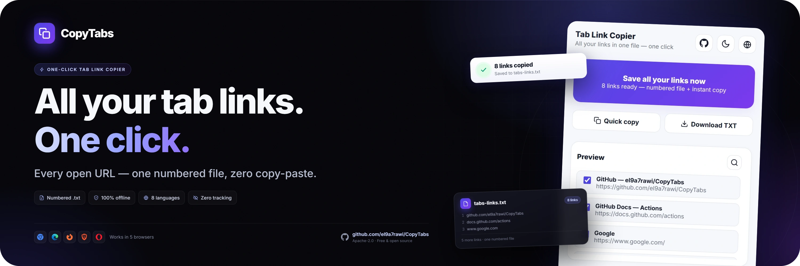
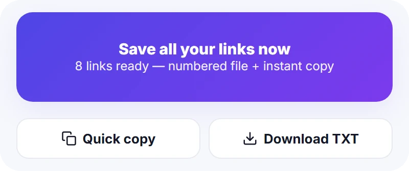
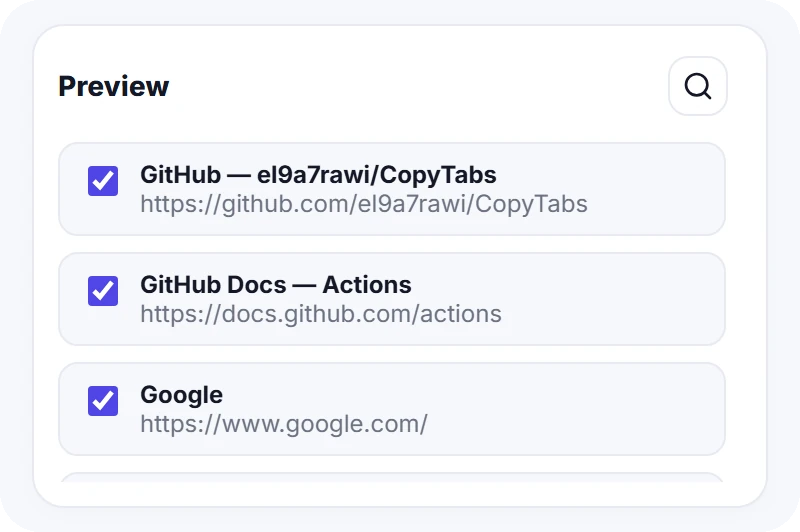
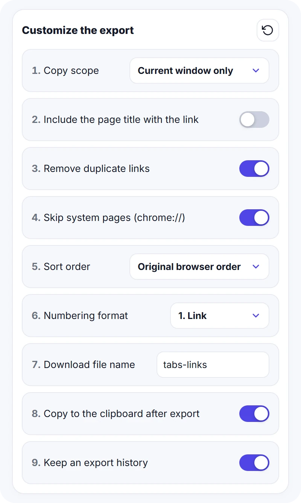
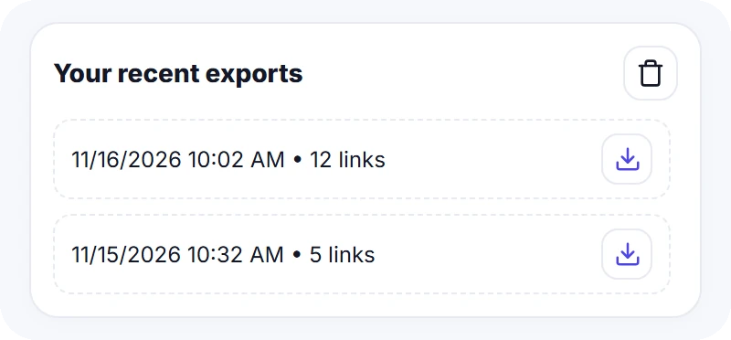
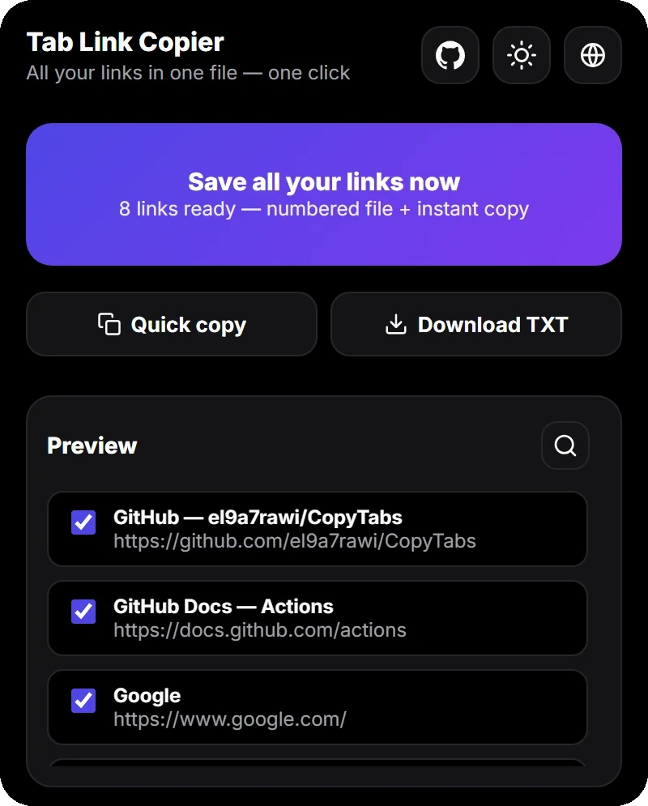
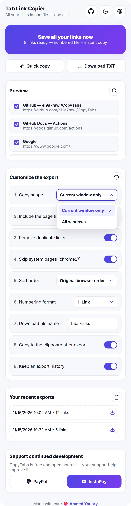
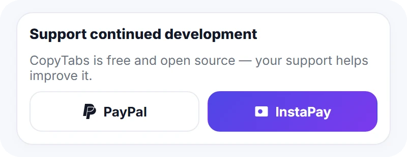
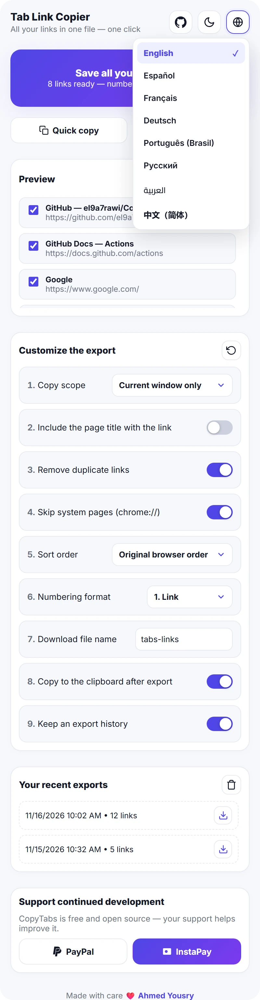

<p align="center">
  
</p>

<h1 align="center">CopyTabs — One-Click Tab Link Copier</h1>

<p align="center">Fifteen tabs open for one research session? CopyTabs collects every open URL into a single numbered <code>.txt</code> file and your clipboard in one click — no manual copy-paste, fully offline. The interface is English by default, ships with eight languages, and mirrors itself completely for Arabic RTL.</p>

<p align="center">
  <a href="https://github.com/el9a7rawi/CopyTabs/releases"></a>
  <a href="https://github.com/el9a7rawi/CopyTabs/blob/main/LICENSE"></a>
  <a href="https://github.com/el9a7rawi/CopyTabs/pulls"></a>
  <a href="https://developer.chrome.com/docs/extensions"></a>
  
  
</p>

<p align="center">
  <a href="README.md"><b>English</b></a> · <a href="README.es.md">Español</a> · <a href="README.fr.md">Français</a> · <a href="README.de.md">Deutsch</a> · <a href="README.pt-BR.md">Português (Brasil)</a> · <a href="README.ru.md">Русский</a> · <a href="README.ar.md">العربية</a> · <a href="README.zh-CN.md">中文（简体）</a>
</p>

<h3 align="center">Download for your browser — click the icon</h3>

<div align="center">

| [<br><b>Chrome</b>](https://github.com/el9a7rawi/CopyTabs/releases/latest) | [<br><b>Edge</b>](https://github.com/el9a7rawi/CopyTabs/releases/latest) | [<br><b>Firefox</b>](https://github.com/el9a7rawi/CopyTabs/releases/latest) | [<br><b>Brave</b>](https://github.com/el9a7rawi/CopyTabs/releases/latest) | [<br><b>Opera</b>](https://github.com/el9a7rawi/CopyTabs/releases/latest) |
|---|---|---|---|---|

</div>

---

## 1. Why CopyTabs?

<div align="center">

| Without CopyTabs | With CopyTabs |
|---|---|
| Copy every URL by hand and paste it into a file | One click collects all links, already numbered |
| A research session is lost when the browser closes | A saved file, a clipboard copy, and an export history |
| Duplicate links and internal pages you never wanted | Duplicates removed and system pages skipped automatically |

</div>

<div dir="ltr">

```text
1. https://www.google.com/
2. https://developer.chrome.com/docs/extensions/
3. https://github.com/
```

</div>

---

## 2. How it works — three steps

1. **Open** CopyTabs from the browser toolbar: every open tab is listed with a live count under the primary button.
2. **Click** the primary action (or review the preview and pick individual links with the per-link toggle).
3. **Share** — the `.txt` file downloads instantly, the same text lands in your clipboard, and a copy is kept in your export history.

---

## 3. Interface tour

### 3.1 The three export actions

<p align="center"></p>

- **Save all links now** — the primary action: exports the selected links, downloads the file, and copies the text to the clipboard in one click, with a live count of ready links underneath.
- **Quick copy** — clipboard only, no file download.
- **Download TXT** — file only, no clipboard write.
- A status line under the buttons confirms success or explains the error — and disappears completely when there is nothing to report, so it never leaves an empty gap.

### 3.2 Live preview and search

<p align="center"></p>

- Every link gets its own card: title, URL, and a **dedicated toggle** — unchecking a link removes it from the export.
- The magnifying-glass icon expands into a search field with a smooth transition, filtering the preview **as you type** by title or URL.
- The centered **×** clears the text while the bar stays open; close it with the icon again or with `Escape`.
- URLs are rendered left-to-right so they never break inside the interface.

### 3.3 Customize the export

<p align="center"></p>

- **Three custom dropdowns** with their own design (not native OS menus): scope, sort order, and numbering format — all keyboard- and screen-reader-accessible.
- **Switches**: include page titles, remove duplicates, skip system pages, auto-copy to clipboard, keep export history.
- **File name field** (up to 60 characters, with automatic sanitizing of invalid characters and an automatic date stamp).
- The **reset button** (circular arrow at the top of the section) restores every option to its default.
- The full list of options is in section 5 below.

### 3.4 Your recent exports

<p align="center"></p>

- The last **10 exports**: date, time, and link count for each run.
- A **download** button for every saved copy, plus a **clear history** button (trash icon) at the top of the section.
- A friendly empty state before the first export — your first run shows up here the moment it finishes.

### 3.5 True black dark theme

<p align="center"></p>

A real black background (`#000000`) with tuned contrast, toggled by the sun/moon icon in the header and remembered automatically.

### 3.6 Dropdowns with their own design

<p align="center"></p>

No default Windows menus: scope, sort order, and numbering are clean floating panels with a check mark, full keyboard support, and screen-reader labels.

### 3.7 Support continued development

<p align="center"></p>

- An optional section for anyone who wants to back the project — CopyTabs stays free and open source.
- A highlighted InstaPay button with PayPal as an alternative — both open in a new tab, and the extension sends no data.

---

## 4. Eight languages — English first, RTL done right

<p align="center"></p>

- **English is the default.** On the very first run CopyTabs follows the browser language when it is one of the eight, then remembers your explicit choice forever.
- **Switch instantly** from the globe icon in the header — no reload, no restart. The choice is stored in the same settings object as every other option.
- **Eight complete dictionaries**: English, Español, Français, Deutsch, Português (Brasil), Русский, العربية, and 中文（简体）. Every string — buttons, options, status messages, history — is translated; nothing falls back to English mid-screen.
- **Real RTL, not a mirrored hack.** Choosing العربية flips the document direction logically: the header, search field, dropdowns, icons, and switches all move to their correct sides, and URLs stay left-to-right inside their cards.
- **Real plurals.** Counts are formatted with `Intl.PluralRules`, so Arabic gets its full zero/one/two/few/many/other set, Russian its four forms, and Chinese its single form — no "1 links" anywhere.
- **Fully offline.** Every dictionary ships inside the extension; switching languages makes zero network requests.
- **Each language has its own README** with screenshots of that language — use the language picker at the top of any page.

---

## 5. Ten controls that shape every export

1. **Scope** — current window only, or every window.
2. **Include page titles** — lines formatted as `1. Title — URL`.
3. **Remove duplicate links** — applied automatically before export.
4. **Skip system pages** — ignores the current browser's internal pages (`chrome://`, `edge://`, `about:`, and similar).
5. **Sort order** — original browser order, alphabetical, or by domain.
6. **Numbering format** — `1.`, `1)`, or `-`.
7. **Custom file name** — with an automatic date stamp: `tabs-links-YYYY-MM-DD.txt`.
8. **Auto-copy to clipboard** — after every export.
9. **Dark theme** — the sun/moon toggle in the header, remembered automatically.
10. **Export history** — the last 10 runs, with re-download and a clear button.

On top of that: live search, an individual toggle per link, a toolbar badge for the ready count, a context menu, two keyboard shortcuts, and a reset button.

---

## 6. Export file examples

Without titles:

<div dir="ltr">

```text
1. https://www.google.com/
2. https://developer.chrome.com/docs/extensions/
3. https://github.com/
```

</div>

With **include page titles** enabled:

<div dir="ltr">

```text
1. Google — https://www.google.com/
2. Chrome Extensions — https://developer.chrome.com/docs/extensions/
```

</div>

---

## 7. Installation — one minute

Open the [Releases](https://github.com/el9a7rawi/CopyTabs/releases) page and download the latest build — **one archive per browser**: Chrome, Edge, Brave, Opera, and Firefox (the four Chromium archives are identical, while the Firefox archive carries the Gecko settings).

**Chrome / Edge / Brave / Opera** (file `copytabs-<browser>-vX.Y.Z.zip` — for example `copytabs-edge-v1.3.1.zip`):

1. Unzip the archive.
2. Open `chrome://extensions` (or the equivalent page) and enable **Developer mode**.
3. Choose **Load unpacked**, select the unzipped folder, then pin the toolbar icon.

**Firefox** (file `copytabs-firefox-vX.Y.Z.zip`):

1. Unzip the archive.
2. Open `about:debugging` → This Firefox → Load Temporary Add-on → select `manifest.json`.
3. A signed build is coming soon on the AMO add-on page.

**For developers working from source:** `git clone` the repository, then load the folder directly as an unpacked extension for Chromium browsers; for Firefox use the build output (`python tools/build.py`) — the source manifest ships without `background.scripts` (required for Chrome).

> No build step, no dependencies — every code change needs only a **Reload** from the extensions page. Requirements: Chrome / Edge / Brave / Opera / Firefox 121 or newer.

---

## 8. Privacy comes first

<div align="center">

| Principle | How it is applied |
|---|---|
| Works fully offline | Only the optional Google Fonts stylesheet; no data is sent anywhere |
| Least privilege | Only `tabs`, `storage`, `contextMenus`, and `downloads` |
| Your data stays on your device | Settings and history live in `storage.local` — no link is ever sent to a server |

</div>

---

## 9. Frequently asked questions

**9.1 Does it work without an internet connection?**
Yes, entirely; the only remote resources are the Inter, Cairo, and Tajawal font stylesheets from Google Fonts, and the extension falls back to local fonts automatically when they are unreachable. Every language dictionary is bundled locally.

**9.2 Is any of my data collected?**
No. No link, setting, or preference is ever sent anywhere — you can verify that yourself in the source.

**9.3 How do I change the numbering format?**
Open *Customize the export → Numbering format*: `1.`, `1)`, or `-`.

**9.4 Why is a tab missing from my export?**
Check that it is still selected in the preview, that it is not a system page you chose to skip, and that it was not removed as a duplicate.

**9.5 How do I change the interface language?**
Click the globe icon in the header and pick a language. The default is English; the first run follows your browser language when it is supported, and your choice is remembered after that.

---

## 10. For developers

<div dir="ltr">

```text
├── manifest.json      ← single source MV3 manifest (the build emits one variant per browser)
├── popup.html/css/js  ← the interface (Inter first, Cairo/Tajawal for Arabic, logical RTL)
├── i18n.js            ← locale loader, plural rules, direction switching
├── browser.js         ← host browser detection + shared system-page prefixes
├── core.js            ← pure tab/link logic shared by popup and background
├── preview.js         ← preview renderer with node reuse for fast search
├── locales/           ← eight complete dictionaries (en, es, fr, de, pt-BR, ru, ar, zh-CN)
├── background.js      ← one shared background: service_worker, emitted as scripts for Firefox
├── icons/             ← 16 / 32 / 48 / 128
├── assets/            ← README screenshots per language, brand covers, and browser icons
├── tools/build.py     ← store builds + SHA256 (used by CI and releases)
├── tools/check_locales.py ← key parity, plural categories, placeholder validation
├── tools/check_readme_assets.py ← verifies every README image link
├── tools/screenshots.py   ← regenerates every README screenshot from the real popup
├── tools/bench.py     ← 100-tab benchmark (headless Chrome + mocked extension APIs)
└── tools/test_*.mjs   ← Node tests: core logic, badge behaviour, preview node reuse
```

</div>

English by default with eight bundled locales and a logical RTL layout, `textContent` only when rendering data (never `innerHTML`), and settings stored in `chrome.storage.local`. Quick verification:

<div dir="ltr">

```powershell
python3 -c "import json; json.load(open('manifest.json')); print('manifest OK')"
python3 tools/check_locales.py
python3 tools/check_readme_assets.py
node --test tools/test_*.mjs
python3 tools/bench.py --tabs 100
python3 tools/build.py
```

</div>

v1.3.1 shares the pure tab/link logic between popup and background, debounces badge updates, and reuses preview rows; `python tools/bench.py --tabs 100` reproduces the measurement.

---

## 11. License and contributing

The project is open source and free for everyone under the **Apache-2.0** license — use it, modify it, and share it freely; the full text is in [LICENSE](LICENSE).

Contributions are welcome: open an issue for bug reports and ideas, or send a pull request directly — CI validates the manifest and every image link before a change is merged.

---

<p align="center">Built with care by <b>Ahmed Yousry</b> · <a href="LICENSE">Apache-2.0</a></p>
