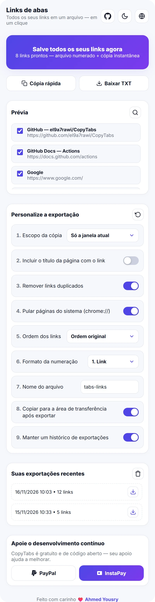
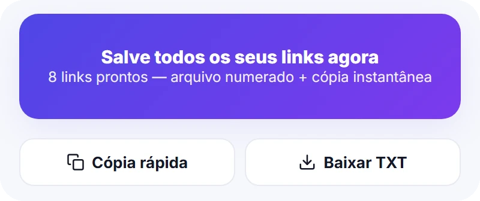
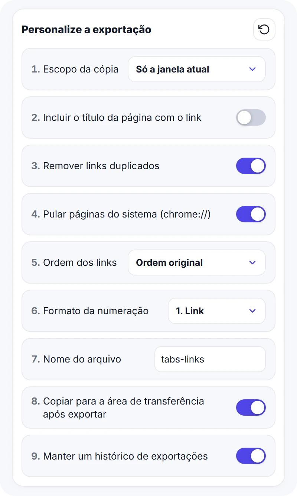

<p align="center">
  
</p>

<h1 align="center">CopyTabs — Copiador de links de abas em um clique</h1>

<p align="center">Quinze abas abertas para uma única pesquisa? O CopyTabs reúne cada URL aberta em um único arquivo <code>.txt</code> numerado e na sua área de transferência com um clique — sem copiar e colar à mão, e totalmente offline. A interface é em inglês por padrão, vem com oito idiomas e se adapta por completo ao árabe RTL.</p>

<p align="center">
  <a href="https://github.com/el9a7rawi/CopyTabs/releases"></a>
  <a href="https://github.com/el9a7rawi/CopyTabs/blob/main/LICENSE"></a>
  <a href="https://github.com/el9a7rawi/CopyTabs/pulls"></a>
  <a href="https://developer.chrome.com/docs/extensions"></a>
  
  
</p>

<p align="center">
  <sub><b>Languages:</b> <a href="README.md">English</a> · <a href="README.es.md">Español</a> · <a href="README.fr.md">Français</a> · <a href="README.de.md">Deutsch</a> · <a href="README.pt-BR.md"><b>Português (Brasil)</b></a> · <a href="README.ru.md">Русский</a> · <a href="README.ar.md">العربية</a> · <a href="README.zh-CN.md">中文（简体）</a></sub>
</p>

<p align="center">
  
</p>

<h3 align="center">Baixe para o seu navegador — clique no ícone</h3>

<div align="center">

| [<br><b>Chrome</b>](https://github.com/el9a7rawi/CopyTabs/releases/latest) | [<br><b>Edge</b>](https://github.com/el9a7rawi/CopyTabs/releases/latest) | [<br><b>Firefox</b>](https://github.com/el9a7rawi/CopyTabs/releases/latest) | [<br><b>Brave</b>](https://github.com/el9a7rawi/CopyTabs/releases/latest) | [<br><b>Opera</b>](https://github.com/el9a7rawi/CopyTabs/releases/latest) |
|---|---|---|---|---|

</div>

<p align="center">
  
</p>

---

## 1. Por que o CopyTabs?

<div align="center">

| Sem o CopyTabs | Com o CopyTabs |
|---|---|
| Copiar cada URL à mão e colar em um arquivo | Um clique reúne todos os links, já numerados |
| Uma pesquisa inteira se perde ao fechar o navegador | Um arquivo salvo, uma cópia na área de transferência e um histórico |
| Links duplicados e páginas internas que você não queria | Duplicados removidos e páginas do sistema ignoradas |

</div>

<div dir="ltr">

```text
1. https://www.google.com/
2. https://developer.chrome.com/docs/extensions/
3. https://github.com/
```

</div>

---

## 2. Como funciona — três passos

1. **Abra** o CopyTabs na barra de ferramentas: cada aba aberta aparece com uma contagem ao vivo no texto do botão principal.
2. **Clique** na ação principal ou revise a prévia e escolha links específicos com o interruptor de cada um.
3. **Compartilhe** — o arquivo `.txt` baixa na hora, o mesmo texto vai para a área de transferência e uma cópia fica no histórico.

---

## 3. Um passeio pela interface

### 3.1 As três ações de exportação

<p align="center"></p>

- **Salve todos os seus links agora** — a ação principal: exporta os links selecionados, baixa o arquivo e copia o texto para a área de transferência com um clique, com uma contagem ao vivo embaixo.
- **Cópia rápida** — só a área de transferência, sem arquivo.
- **Baixar TXT** — só o arquivo, sem escrever na área de transferência.
- Uma linha de status abaixo dos botões confirma o sucesso ou explica o erro — e desaparece por completo quando não há nada a dizer.

### 3.2 Prévia e pesquisa ao vivo

- Cada link tem seu próprio cartão: título, URL e um **interruptor dedicado** — desmarcar remove o link da exportação.
- O ícone da lupa se expande em um campo de pesquisa com transição suave e filtra a prévia **enquanto você digita**, por título ou URL.
- O **×** centralizado limpa o texto e mantém a barra aberta; feche-a pelo ícone outra vez ou com `Esc`.
- As URLs aparecem da esquerda para a direita para nunca quebrarem dentro da interface.

### 3.3 Personalize a exportação

<p align="center"></p>

- **Três menus suspensos próprios** (nada de menus do sistema): escopo, ordem e formato de numeração — todos acessíveis por teclado e leitor de tela.
- **Interruptores**: incluir títulos, remover duplicados, pular páginas do sistema, copiar automaticamente e manter histórico.
- **Campo de nome do arquivo** (até 60 caracteres, com limpeza automática de caracteres inválidos e data automática).
- O **botão de restaurar** (seta circular no topo da seção) devolve cada opção ao padrão.
- A lista completa está na seção 5.

### 3.4 Suas exportações recentes

- As últimas **10 exportações**: data, hora e quantidade de links.
- Um botão de **download** para cada cópia salva e um botão de **limpar histórico** (lixeira) no topo.
- Um estado vazio acolhedor antes da primeira exportação — a primeira execução aparece aqui assim que termina.

### 3.5 Tema escuro preto de verdade

Fundo preto real (`#000000`) com contraste ajustado, alternado pelo ícone sol/lua no cabeçalho e lembrado automaticamente.

### 3.6 Menus com design próprio

Nada de menus padrão do Windows: escopo, ordem e numeração são painéis flutuantes caprichados com marca de seleção, suporte completo a teclado e rótulos para leitores de tela.

### 3.7 Apoie o desenvolvimento contínuo

- Uma seção opcional para quem quiser apoiar o projeto — o CopyTabs continua gratuito e de código aberto.
- Um botão InstaPay em destaque, com PayPal como alternativa — os dois abrem em uma nova aba e a extensão não envia dados.

---

## 4. Oito idiomas — inglês primeiro e RTL bem feito

- **O inglês é o padrão.** Na primeira execução o CopyTabs segue o idioma do navegador quando ele é um dos oito, e depois lembra sua escolha para sempre.
- **Troque na hora** pelo ícone do globo no cabeçalho — sem recarregar nem reiniciar. A escolha fica no mesmo objeto de configurações das outras opções.
- **Oito dicionários completos**: English, Español, Français, Deutsch, Português (Brasil), Русский, العربية e 中文（简体）. Tudo é traduzido — botões, opções, mensagens de status e histórico; nada volta ao inglês no meio da tela.
- **RTL de verdade, não um espelho superficial.** Escolher العربية inverte a direção lógica do documento: cabeçalho, pesquisa, menus, ícones e interruptores vão para o lado correto, e as URLs continuam da esquerda para a direita nos cartões.
- **Plurais reais.** As contagens usam `Intl.PluralRules`: o árabe recebe as seis formas, o russo as quatro e o chinês a forma única — nunca “1 links”.
- **Totalmente offline.** Cada dicionário vem dentro da extensão; trocar de idioma não faz nenhuma requisição de rede.
- **Cada idioma tem seu próprio README** com capturas da sua interface — use o seletor de idioma no topo.

---

## 5. Dez controles que moldam cada exportação

1. **Escopo** — só a janela atual ou todas as janelas.
2. **Incluir títulos** — linhas no formato `1. Título — URL`.
3. **Remover links duplicados** — aplicado automaticamente antes de exportar.
4. **Pular páginas do sistema** — ignora as páginas internas do seu navegador (`chrome://`, `edge://`, `about:` e similares).
5. **Ordem** — ordem original, alfabética ou por domínio.
6. **Formato da numeração** — `1.`, `1)` ou `-`.
7. **Nome do arquivo** — com data automática: `tabs-links-YYYY-MM-DD.txt`.
8. **Cópia automática** — para a área de transferência após cada exportação.
9. **Tema escuro** — o botão sol/lua no cabeçalho, lembrado automaticamente.
10. **Histórico** — as últimas 10 execuções, com novo download e limpeza.

Além disso: pesquisa ao vivo, interruptor por link, um selo de contagem na barra de ferramentas, menu de contexto, dois atalhos de teclado e um botão de restaurar.

---

## 6. Exemplos do arquivo exportado

Sem títulos:

<div dir="ltr">

```text
1. https://www.google.com/
2. https://developer.chrome.com/docs/extensions/
3. https://github.com/
```

</div>

Com **incluir títulos** ativado:

<div dir="ltr">

```text
1. Google — https://www.google.com/
2. Chrome Extensions — https://developer.chrome.com/docs/extensions/
```

</div>

---

## 7. Instalação — um minuto

Abra a página de [Releases](https://github.com/el9a7rawi/CopyTabs/releases) e baixe a compilação mais recente — **um arquivo por navegador**: Chrome, Edge, Brave, Opera e Firefox (os quatro de Chromium são idênticos; o do Firefox traz as configurações do Gecko).

**Chrome / Edge / Brave / Opera** (arquivo `copytabs-<browser>-vX.Y.Z.zip`, por exemplo `copytabs-edge-v1.3.0.zip`):

1. Descompacte o arquivo.
2. Abra `chrome://extensions` (ou a página equivalente) e ative o **modo desenvolvedor**.
3. Escolha **Carregar sem compactação**, selecione a pasta e fixe o ícone na barra.

**Firefox** (arquivo `copytabs-firefox-vX.Y.Z.zip`):

1. Descompacte o arquivo.
2. Abra `about:debugging` → This Firefox → Load Temporary Add-on → selecione `manifest.json`.
3. A versão assinada fica sempre na página da AMO (em breve).

**Para desenvolvedores a partir do código:** faça `git clone` do repositório e carregue a pasta como extensão sem compactação nos navegadores Chromium; para o Firefox use a saída de `python tools/build.py` — o manifest de origem vem sem `background.scripts` (necessário no Chrome).

> Sem etapa de build, sem dependências — cada mudança precisa apenas de **Reload** na página de extensões. Requisitos: Chrome / Edge / Brave / Opera / Firefox 121 ou mais novo.

---

## 8. Privacidade em primeiro lugar

<div align="center">

| Princípio | Como é aplicado |
|---|---|
| Funciona totalmente offline | Zero requisições de rede |
| Permissões mínimas | Apenas `tabs`, `storage`, `contextMenus` e `downloads` |
| Seus dados ficam no seu dispositivo | Configurações e histórico em `storage.local` — nenhum link é enviado a um servidor |

</div>

---

## 9. Perguntas frequentes

**9.1 Funciona sem internet?**
Sim, por completo; o único recurso remoto são as folhas de estilo das fontes Inter e Cairo do Google Fonts, e a extensão volta às fontes locais automaticamente quando elas não carregam. Cada dicionário é incluído localmente.

**9.2 Algum dado meu é coletado?**
Não. A extensão não contém nenhum código de rede — você pode verificar isso no código-fonte.

**9.3 Como mudo o formato da numeração?**
Abra *Personalize a exportação → Formato da numeração*: `1.`, `1)` ou `-`.

**9.4 Por que uma aba está faltando na exportação?**
Verifique se ela continua marcada na prévia, se não é uma página do sistema que você escolheu pular e se não foi removida como duplicada.

**9.5 Como mudo o idioma da interface?**
Clique no globo no cabeçalho e escolha um idioma. O padrão é inglês; a primeira execução segue o idioma do navegador quando há suporte, e sua escolha é lembrada depois.

---

## 10. Para desenvolvedores

<div dir="ltr">

```text
├── manifest.json      ← single source MV3 manifest (the build emits one variant per browser)
├── popup.html/css/js  ← the interface (Inter first, Cairo/Tajawal for Arabic, logical RTL)
├── i18n.js            ← locale loader, plural rules, direction switching
├── browser.js         ← host browser detection + shared system-page prefixes
├── locales/           ← eight complete dictionaries (en, es, fr, de, pt-BR, ru, ar, zh-CN)
├── background.js      ← one shared background: service_worker, emitted as scripts for Firefox
├── icons/             ← 16 / 32 / 48 / 128
├── assets/            ← README screenshots (one folder per language) + browser icons
├── tools/build.py     ← store builds + SHA256 (used by CI and releases)
├── tools/check_locales.py ← key parity, plural categories, placeholder validation
└── tools/screenshots.py   ← regenerates every README screenshot from the real popup
```

</div>

Inglês por padrão com oito locales incluídos e layout RTL lógico, `textContent` apenas ao exibir dados (nunca `innerHTML`) e configurações em `chrome.storage.local`. Verificação rápida:

<div dir="ltr">

```powershell
python3 -c "import json; json.load(open('manifest.json')); print('manifest OK')"
python3 tools/check_locales.py
```

</div>

---

## 11. Licença e contribuições

O projeto é de código aberto e gratuito para todos sob a licença **Apache-2.0** — use, modifique e compartilhe à vontade; o texto completo está em [LICENSE](LICENSE).

Contribuições são bem-vindas: abra uma issue para bugs e ideias, ou envie um pull request direto — a CI valida o manifest e cada link de imagem antes do merge.

---

<p align="center">Feito com carinho por <b>Ahmed Yousry</b> · <a href="LICENSE">Apache-2.0</a></p>
