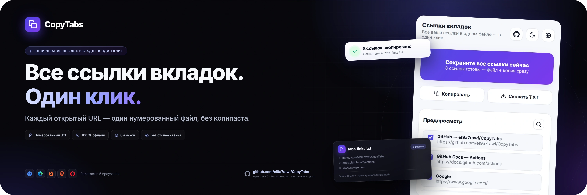
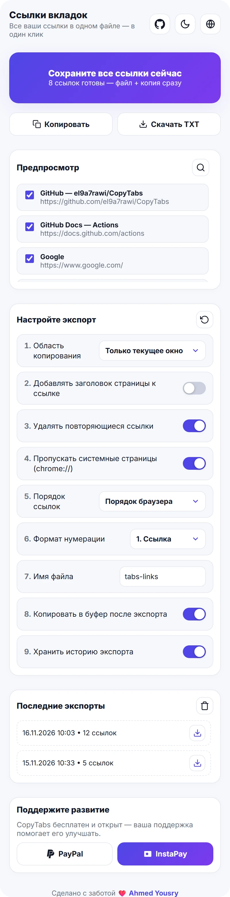
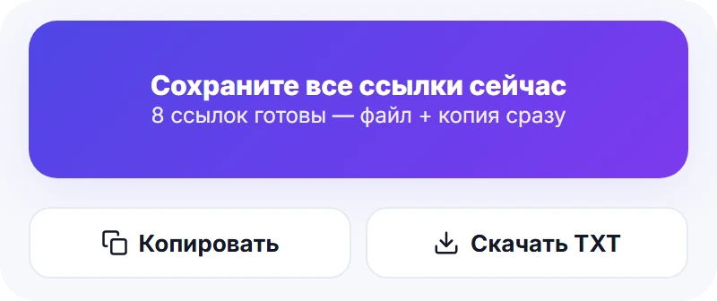
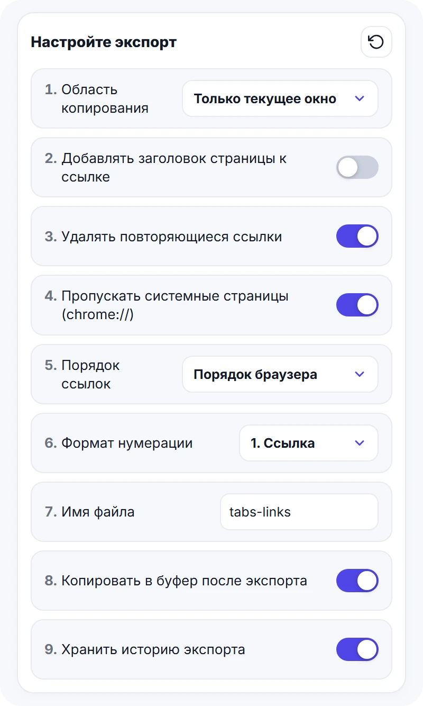

<p align="center">
  
</p>

<h1 align="center">CopyTabs — Копирование ссылок вкладок в один клик</h1>

<p align="center">Пятнадцать вкладок ради одного исследования? CopyTabs собирает каждый открытый URL в один нумерованный файл <code>.txt</code> и в буфер обмена одним кликом — без ручного копирования и вставки, полностью офлайн. Интерфейс по умолчанию английский, включает восемь языков и полностью зеркалируется для арабского RTL.</p>

<p align="center">
  <a href="https://github.com/el9a7rawi/CopyTabs/releases"></a>
  <a href="https://github.com/el9a7rawi/CopyTabs/blob/main/LICENSE"></a>
  <a href="https://github.com/el9a7rawi/CopyTabs/pulls"></a>
  <a href="https://developer.chrome.com/docs/extensions"></a>
  
  
</p>

<p align="center">
  <sub><b>Languages:</b> <a href="README.md">English</a> · <a href="README.es.md">Español</a> · <a href="README.fr.md">Français</a> · <a href="README.de.md">Deutsch</a> · <a href="README.pt-BR.md">Português (Brasil)</a> · <a href="README.ru.md"><b>Русский</b></a> · <a href="README.ar.md">العربية</a> · <a href="README.zh-CN.md">中文（简体）</a></sub>
</p>

<p align="center">
  
</p>

<h3 align="center">Скачайте для своего браузера — нажмите на значок</h3>

<div align="center">

| [<br><b>Chrome</b>](https://github.com/el9a7rawi/CopyTabs/releases/latest) | [<br><b>Edge</b>](https://github.com/el9a7rawi/CopyTabs/releases/latest) | [<br><b>Firefox</b>](https://github.com/el9a7rawi/CopyTabs/releases/latest) | [<br><b>Brave</b>](https://github.com/el9a7rawi/CopyTabs/releases/latest) | [<br><b>Opera</b>](https://github.com/el9a7rawi/CopyTabs/releases/latest) |
|---|---|---|---|---|

</div>

<p align="center">
  
</p>

---

## 1. Зачем CopyTabs?

<div align="center">

| Без CopyTabs | С CopyTabs |
|---|---|
| Копировать каждый URL вручную и вставлять в файл | Один клик собирает все ссылки уже с нумерацией |
| Исследование теряется при закрытии браузера | Сохранённый файл, копия в буфере и история экспорта |
| Дубликаты и внутренние страницы, которые не нужны | Дубликаты удалены, системные страницы пропущены |

</div>

<div dir="ltr">

```text
1. https://www.google.com/
2. https://developer.chrome.com/docs/extensions/
3. https://github.com/
```

</div>

---

## 2. Как это работает — три шага

1. **Откройте** CopyTabs на панели инструментов: каждая открытая вкладка появляется с живым счётчиком в тексте главного действия.
2. **Нажмите** главное действие или просмотрите предпросмотр и выберите отдельные ссылки их переключателями.
3. **Поделитесь** — файл `.txt` скачивается сразу, тот же текст попадает в буфер обмена, а копия остаётся в истории.

---

## 3. Знакомство с интерфейсом

### 3.1 Три действия экспорта

<p align="center"></p>

- **Сохраните все ссылки сейчас** — главное действие: экспортирует выбранные ссылки, скачивает файл и копирует текст в буфер обмена одним кликом, с живым счётчиком под кнопкой.
- **Копировать** — только буфер обмена, без файла.
- **Скачать TXT** — только файл, без записи в буфер.
- Строка состояния под кнопками подтверждает успех или объясняет ошибку — и полностью исчезает, когда сообщать нечего.

### 3.2 Живой предпросмотр и поиск

- У каждой ссылки своя карточка: заголовок, URL и **отдельный переключатель** — снятие отметки исключает ссылку из экспорта.
- Значок лупы раскрывается в поле поиска с плавным переходом и фильтрует предпросмотр **по мере ввода** по заголовку или URL.
- Центрированный **×** очищает текст, оставляя панель открытой; закройте её значком ещё раз или клавишей `Escape`.
- URL отображаются слева направо, поэтому никогда не ломаются внутри интерфейса.

### 3.3 Настройте экспорт

<p align="center"></p>

- **Три собственных выпадающих списка** (не системные меню): область, порядок и формат нумерации — все доступны с клавиатуры и для экранных дикторов.
- **Переключатели**: добавлять заголовки, удалять дубликаты, пропускать системные страницы, копировать автоматически, хранить историю.
- **Поле имени файла** (до 60 символов, с автоматической очисткой недопустимых символов и датой).
- **Кнопка сброса** (круговая стрелка вверху раздела) возвращает все параметры к значениям по умолчанию.
- Полный список — в разделе 5.

### 3.4 Ваши последние экспорты

- Последние **10 экспортов**: дата, время и количество ссылок.
- Кнопка **скачивания** для каждой сохранённой копии и кнопка **очистить историю** (корзина) вверху.
- Дружелюбное пустое состояние до первого экспорта — первый запуск появится здесь сразу после завершения.

### 3.5 По-настоящему чёрная тёмная тема

Настоящий чёрный фон (`#000000`) с выверенным контрастом, переключается значком солнца/луны в шапке и запоминается автоматически.

### 3.6 Меню с собственным дизайном

Никаких стандартных меню Windows: область, порядок и нумерация — аккуратные плавающие панели с галочкой, полной поддержкой клавиатуры и подписями для экранных дикторов.

### 3.7 Поддержите развитие

- Необязательный раздел для тех, кто хочет поддержать проект — CopyTabs остаётся бесплатным и открытым.
- Выделенная кнопка InstaPay и PayPal как альтернатива — обе открываются в новой вкладке, расширение не отправляет данные.

---

## 4. Восемь языков — английский первым и настоящий RTL

- **Английский — язык по умолчанию.** При первом запуске CopyTabs следует языку браузера, если он один из восьми, а затем навсегда запоминает ваш выбор.
- **Меняйте мгновенно** через значок глобуса в шапке — без перезагрузки и перезапуска. Выбор хранится в том же объекте настроек, что и остальные параметры.
- **Восемь полных словарей**: English, Español, Français, Deutsch, Português (Brasil), Русский, العربية и 中文（简体）. Переведено всё — кнопки, параметры, сообщения и история; ничего не откатывается на английский посреди экрана.
- **Настоящий RTL, а не поверхностное зеркало.** Выбор العربية логически меняет направление документа: шапка, поиск, меню, значки и переключатели встают на нужную сторону, а URL остаются слева направо внутри карточек.
- **Настоящие формы множественного числа.** Счётчики используют `Intl.PluralRules`: арабский получает все шесть форм, русский — четыре, китайский — одну; никаких «1 ссылки».
- **Полностью офлайн.** Каждый словарь встроен в расширение; смена языка не делает ни одного сетевого запроса.
- **У каждого языка свой README** со снимками его интерфейса — используйте выбор языка вверху.

---

## 5. Десять параметров, которые формируют каждый экспорт

1. **Область** — только текущее окно или все окна.
2. **Добавлять заголовки** — строки вида `1. Заголовок — URL`.
3. **Удалять дубликаты** — применяется автоматически перед экспортом.
4. **Пропускать системные страницы** — игнорирует внутренние страницы вашего браузера (`chrome://`, `edge://`, `about:` и подобные).
5. **Порядок** — исходный порядок браузера, по алфавиту или по домену.
6. **Формат нумерации** — `1.`, `1)` или `-`.
7. **Имя файла** — с автоматической датой: `tabs-links-YYYY-MM-DD.txt`.
8. **Автокопирование** — в буфер обмена после каждого экспорта.
9. **Тёмная тема** — кнопка солнца/луны в шапке, запоминается автоматически.
10. **История экспорта** — последние 10 запусков, с повторным скачиванием и очисткой.

Вдобавок: живой поиск, переключатель для каждой ссылки, значок счётчика на панели инструментов, контекстное меню, два сочетания клавиш и кнопка сброса.

---

## 6. Примеры файла экспорта

Без заголовков:

<div dir="ltr">

```text
1. https://www.google.com/
2. https://developer.chrome.com/docs/extensions/
3. https://github.com/
```

</div>

С включёнными **заголовками**:

<div dir="ltr">

```text
1. Google — https://www.google.com/
2. Chrome Extensions — https://developer.chrome.com/docs/extensions/
```

</div>

---

## 7. Установка — одна минута

Откройте страницу [Releases](https://github.com/el9a7rawi/CopyTabs/releases) и скачайте последнюю сборку — **один архив на браузер**: Chrome, Edge, Brave, Opera и Firefox (четыре архива Chromium одинаковы; архив Firefox содержит настройки Gecko).

**Chrome / Edge / Brave / Opera** (файл `copytabs-<browser>-vX.Y.Z.zip`, например `copytabs-edge-v1.3.0.zip`):

1. Распакуйте архив.
2. Откройте `chrome://extensions` (или аналогичную страницу) и включите **режим разработчика**.
3. Выберите **Загрузить распакованное расширение**, укажите папку и закрепите значок.

**Firefox** (файл `copytabs-firefox-vX.Y.Z.zip`):

1. Распакуйте архив.
2. Откройте `about:debugging` → This Firefox → Load Temporary Add-on → выберите `manifest.json`.
3. Подписанная сборка всегда доступна на странице AMO (скоро).

**Для разработчиков из исходников:** сделайте `git clone`, затем загрузите папку как распакованное расширение в Chromium-браузерах; для Firefox используйте результат `python tools/build.py` — исходный manifest идёт без `background.scripts` (нужно для Chrome).

> Без шага сборки и зависимостей — любое изменение требует лишь **Reload** на странице расширений. Требования: Chrome / Edge / Brave / Opera / Firefox 121 или новее.

---

## 8. Приватность прежде всего

<div align="center">

| Принцип | Как реализовано |
|---|---|
| Полностью офлайн | Ноль сетевых запросов |
| Минимум разрешений | Только `tabs`, `storage`, `contextMenus` и `downloads` |
| Данные остаются у вас | Настройки и история в `storage.local` — ни одна ссылка не уходит на сервер |

</div>

---

## 9. Частые вопросы

**9.1 Работает ли без интернета?**
Да, полностью; единственный внешний ресурс — таблицы стилей шрифтов Inter и Cairo с Google Fonts, и при недоступности расширение автоматически переходит на локальные шрифты. Каждый словарь встроен локально.

**9.2 Собираются ли мои данные?**
Нет. В расширении вообще нет сетевого кода — это можно проверить в исходниках.

**9.3 Как изменить формат нумерации?**
Откройте *Настройте экспорт → Формат нумерации*: `1.`, `1)` или `-`.

**9.4 Почему вкладка пропала из экспорта?**
Проверьте, что она всё ещё отмечена в предпросмотре, не является пропущенной системной страницей и не удалена как дубликат.

**9.5 Как изменить язык интерфейса?**
Нажмите на глобус в шапке и выберите язык. По умолчанию английский; первый запуск следует языку браузера, если он поддерживается, а затем выбор запоминается.

---

## 10. Для разработчиков

<div dir="ltr">

```text
├── manifest.json      ← single source MV3 manifest (the build emits one variant per browser)
├── popup.html/css/js  ← the interface (Inter first, Cairo/Tajawal for Arabic, logical RTL)
├── i18n.js            ← locale loader, plural rules, direction switching
├── browser.js         ← host browser detection + shared system-page prefixes
├── locales/           ← eight complete dictionaries (en, es, fr, de, pt-BR, ru, ar, zh-CN)
├── background.js      ← one shared background: service_worker, emitted as scripts for Firefox
├── icons/             ← 16 / 32 / 48 / 128
├── assets/            ← README screenshots (one folder per language) + browser icons
├── tools/build.py     ← store builds + SHA256 (used by CI and releases)
├── tools/check_locales.py ← key parity, plural categories, placeholder validation
└── tools/screenshots.py   ← regenerates every README screenshot from the real popup
```

</div>

Английский по умолчанию, восемь встроенных локалей и логичный RTL-макет, `textContent` только для вывода данных (никогда `innerHTML`), настройки в `chrome.storage.local`. Быстрая проверка:

<div dir="ltr">

```powershell
python3 -c "import json; json.load(open('manifest.json')); print('manifest OK')"
python3 tools/check_locales.py
```

</div>

---

## 11. Лицензия и участие

Проект открытый и бесплатный для всех по лицензии **Apache-2.0** — используйте, изменяйте и делитесь свободно; полный текст в [LICENSE](LICENSE).

Вклад приветствуется: открывайте issue для ошибок и идей или присылайте pull request — CI проверяет manifest и каждую ссылку на изображение перед слиянием.

---

<p align="center">Сделано с заботой — <b>Ahmed Yousry</b> · <a href="LICENSE">Apache-2.0</a></p>
