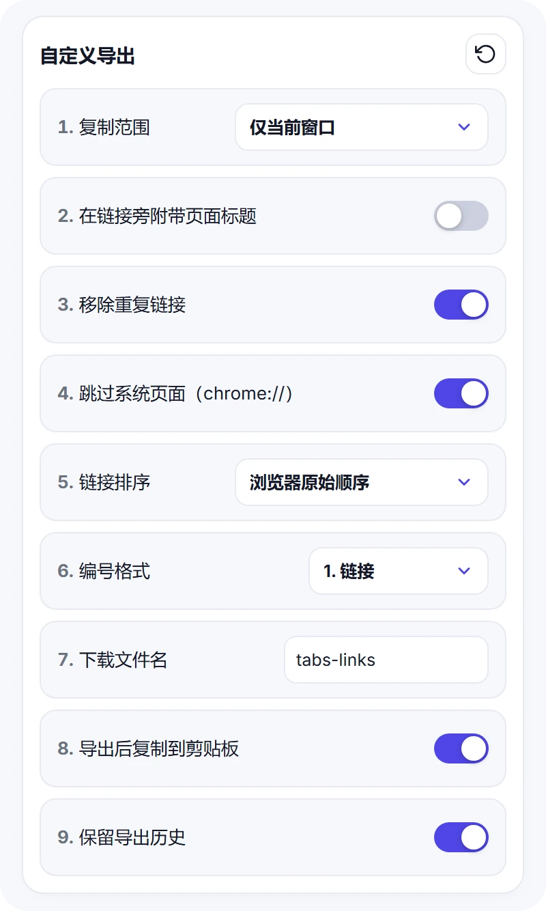

<p align="center">
  
</p>

<h1 align="center">CopyTabs — 一键复制标签页链接</h1>

<p align="center">一次查资料开了十五个标签页？CopyTabs 一键把所有打开的网址收进一个带编号的 <code>.txt</code> 文件，并同步到剪贴板——不用手动复制粘贴，完全离线。界面默认英文，内置八种语言，并为阿拉伯语完整镜像 RTL 布局。</p>

<p align="center">
  <a href="https://github.com/el9a7rawi/CopyTabs/releases"></a>
  <a href="https://github.com/el9a7rawi/CopyTabs/blob/main/LICENSE"></a>
  <a href="https://github.com/el9a7rawi/CopyTabs/pulls"></a>
  <a href="https://developer.chrome.com/docs/extensions"></a>
  
  
</p>

<p align="center">
  <a href="README.md">English</a> · <a href="README.es.md">Español</a> · <a href="README.fr.md">Français</a> · <a href="README.de.md">Deutsch</a> · <a href="README.pt-BR.md">Português (Brasil)</a> · <a href="README.ru.md">Русский</a> · <a href="README.ar.md">العربية</a> · <a href="README.zh-CN.md"><b>中文（简体）</b></a>
</p>

<p align="center">
  
</p>

<h3 align="center">为你的浏览器下载 — 点击图标</h3>

<div align="center">

| [<br><b>Chrome</b>](https://github.com/el9a7rawi/CopyTabs/releases/latest) | [<br><b>Edge</b>](https://github.com/el9a7rawi/CopyTabs/releases/latest) | [<br><b>Firefox</b>](https://github.com/el9a7rawi/CopyTabs/releases/latest) | [<br><b>Brave</b>](https://github.com/el9a7rawi/CopyTabs/releases/latest) | [<br><b>Opera</b>](https://github.com/el9a7rawi/CopyTabs/releases/latest) |
|---|---|---|---|---|

</div>

---

## 1. 为什么选择 CopyTabs？

<div align="center">

| 没有 CopyTabs | 使用 CopyTabs |
|---|---|
| 手动复制每个网址再粘贴到文件里 | 一键收集全部链接，自动编号 |
| 关闭浏览器后，一次查资料的结果全丢了 | 保存文件、复制到剪贴板，还有导出历史 |
| 混进重复链接和不需要的内部页面 | 自动去重并跳过系统页面 |

</div>

<div dir="ltr">

```text
1. https://www.google.com/
2. https://developer.chrome.com/docs/extensions/
3. https://github.com/
```

</div>

---

## 2. 三步完成

1. **打开**工具栏里的 CopyTabs：所有标签页都会列出，主按钮下方显示实时数量。
2. **点击**主操作，或查看预览并用每行的开关挑选需要的链接。
3. **分享** — `.txt` 文件立即下载，同样的文本进入剪贴板，历史记录里也保留一份。

---

## 3. 界面导览

### 3.1 三个导出操作

<p align="center"></p>

- **立即保存所有链接** — 主操作：导出所选链接、下载文件，并一键复制文本到剪贴板，下方显示实时数量。
- **快速复制** — 只复制到剪贴板，不下载文件。
- **下载 TXT** — 只下载文件，不写入剪贴板。
- 按钮下方的状态行会确认成功或说明错误 — 没有内容时完全隐藏，不留空白。

### 3.2 实时预览与搜索

- 每个链接都有独立卡片：标题、网址和一个**独立开关** — 取消勾选即可将它排除在导出之外。
- 放大镜图标会平滑展开为搜索框，**边输入边筛选**预览，可按标题或网址匹配。
- 居中的 **×** 清空文本并保持搜索栏打开；再次点击图标或按 `Escape` 关闭。
- 网址始终从左到右显示，不会在界面中折断。

### 3.3 自定义导出

<p align="center"></p>

- **三个自主设计的下拉菜单**（不是系统菜单）：复制范围、排序方式和编号格式 — 全部支持键盘和屏幕阅读器。
- **开关**：附带页面标题、移除重复链接、跳过系统页面、导出后自动复制、保留导出历史。
- **文件名输入框**（最多 60 个字符，自动清理非法字符并附加日期）。
- **重置按钮**（区块右上角的圆形箭头）把每个选项恢复默认值。
- 完整选项列表见第 5 节。

### 3.4 最近的导出

- 最近 **10 次导出**：日期、时间和链接数量。
- 每份保存的副本都有**下载**按钮，区块顶部还有**清除历史**按钮（垃圾桶图标）。
- 第一次导出前有友好的空状态 — 首次运行结束后会立刻出现在这里。

### 3.5 真正的纯黑深色主题

真正的黑色背景（`#000000`）搭配调校过的对比度，用页眉的太阳/月亮图标切换，并自动记住选择。

### 3.6 自主设计的下拉菜单

没有 Windows 默认菜单：范围、排序和编号都是干净的浮动面板，带勾选标记、完整键盘支持和屏幕阅读器标签。

### 3.7 支持持续开发

- 一个可选区块，供愿意支持项目的人使用 — CopyTabs 始终保持免费和开源。
- 醒目的 InstaPay 按钮，PayPal 作为备选 — 两者都在新标签页打开，扩展不会发送任何数据。

---

## 4. 八种语言 — 英文优先，RTL 做到位

- **默认英文。** 首次运行时，如果浏览器语言属于这八种之一，CopyTabs 会跟随它，之后永久记住你的明确选择。
- **即时切换**：点击页眉的地球图标 — 无需刷新或重启。选择与其他设置保存在同一个对象里。
- **八套完整词典**：English、Español、Français、Deutsch、Português (Brasil)、Русский、العربية 和 中文（简体）。所有内容都已翻译 — 按钮、选项、状态消息和历史；不会在屏幕中间退回英文。
- **真正的 RTL，不是表面镜像。** 选择 العربية 会按逻辑翻转文档方向：页眉、搜索、菜单、图标和开关都移到正确的一侧，网址在卡片内仍保持从左到右。
- **真正的复数规则。** 数量使用 `Intl.PluralRules`：阿拉伯语拥有完整的六种形式，俄语四种，中文一种 — 任何地方都不会出现「1 links」。
- **完全离线。** 每套词典都打包在扩展内；切换语言不会发出任何网络请求。
- **每种语言都有自己的 README**，使用该语言的界面截图 — 使用页面顶部的语言选择器。

---

## 5. 塑造每次导出的十个选项

1. **复制范围** — 仅当前窗口，或所有窗口。
2. **附带页面标题** — 行格式为 `1. 标题 — 网址`。
3. **移除重复链接** — 导出前自动执行。
4. **跳过系统页面** — 忽略浏览器的内部页面（`chrome://`、`edge://`、`about:` 等）。
5. **排序方式** — 浏览器原始顺序、字母顺序或按域名。
6. **编号格式** — `1.`、`1)` 或 `-`。
7. **自定义文件名** — 自动附加日期：`tabs-links-YYYY-MM-DD.txt`。
8. **导出后自动复制** — 写入剪贴板。
9. **深色主题** — 页眉的太阳/月亮按钮，自动记住。
10. **导出历史** — 最近 10 次，可重新下载或清除。

此外还有：实时搜索、每个链接的独立开关、工具栏数量徽章、右键菜单、两个键盘快捷键和重置按钮。

---

## 6. 导出文件示例

不带标题：

<div dir="ltr">

```text
1. https://www.google.com/
2. https://developer.chrome.com/docs/extensions/
3. https://github.com/
```

</div>

开启**附带页面标题**后：

<div dir="ltr">

```text
1. Google — https://www.google.com/
2. Chrome Extensions — https://developer.chrome.com/docs/extensions/
```

</div>

---

## 7. 安装 — 一分钟

打开 [Releases](https://github.com/el9a7rawi/CopyTabs/releases) 页面，下载最新构建 — **每个浏览器一个压缩包**：Chrome、Edge、Brave、Opera 和 Firefox（四个 Chromium 包完全相同；Firefox 包带有 Gecko 设置）。

**Chrome / Edge / Brave / Opera**（文件 `copytabs-<browser>-vX.Y.Z.zip`，例如 `copytabs-edge-v1.3.0.zip`）：

1. 解压压缩包。
2. 打开 `chrome://extensions`（或对应页面），启用**开发者模式**。
3. 选择**加载已解压的扩展程序**，选中文件夹，然后把图标固定到工具栏。

**Firefox**（文件 `copytabs-firefox-vX.Y.Z.zip`）：

1. 解压压缩包。
2. 打开 `about:debugging` → This Firefox → Load Temporary Add-on → 选择 `manifest.json`。
3. 签名版本始终在 AMO 页面提供（即将上线）。

**开发者从源码运行：** `git clone` 仓库，然后在 Chromium 浏览器中直接加载文件夹为未打包扩展；Firefox 请使用 `python tools/build.py` 的构建产物 — 源码 manifest 不带 `background.scripts`（Chrome 需要如此）。

> 没有构建步骤，没有依赖 — 每次修改只需在扩展页面点 **Reload**。要求：Chrome / Edge / Brave / Opera / Firefox 121 或更高版本。

---

## 8. 隐私优先

<div align="center">

| 原则 | 实现方式 |
|---|---|
| 完全离线运行 | 零网络请求 |
| 最小权限 | 仅 `tabs`、`storage`、`contextMenus` 和 `downloads` |
| 数据留在你的设备上 | 设置和历史保存在 `storage.local` — 任何链接都不会发送到服务器 |

</div>

---

## 9. 常见问题

**9.1 没有网络也能用吗？**
可以，完全可用；唯一的远程资源是 Google Fonts 的 Inter 和 Cairo 字体样式表，无法访问时会自动回退到本地字体。每套词典都打包在本地。

**9.2 会收集我的数据吗？**
不会。扩展里没有任何网络代码 — 你可以自己在源码中验证。

**9.3 如何更改编号格式？**
打开 *自定义导出 → 编号格式*：`1.`、`1)` 或 `-`。

**9.4 为什么导出里少了一个标签页？**
请确认它仍在预览中被勾选、不是你选择跳过的系统页面，也没有作为重复项被移除。

**9.5 如何更改界面语言？**
点击页眉的地球图标并选择语言。默认英文；首次运行会跟随受支持的浏览器语言，之后会记住你的选择。

---

## 10. 面向开发者

<div dir="ltr">

```text
├── manifest.json      ← single source MV3 manifest (the build emits one variant per browser)
├── popup.html/css/js  ← the interface (Inter first, Cairo/Tajawal for Arabic, logical RTL)
├── i18n.js            ← locale loader, plural rules, direction switching
├── browser.js         ← host browser detection + shared system-page prefixes
├── core.js            ← pure tab/link logic shared by popup and background
├── preview.js         ← preview renderer with node reuse for fast search
├── locales/           ← eight complete dictionaries (en, es, fr, de, pt-BR, ru, ar, zh-CN)
├── background.js      ← one shared background: service_worker, emitted as scripts for Firefox
├── icons/             ← 16 / 32 / 48 / 128
├── assets/            ← README screenshots (one folder per language) + browser icons
├── tools/build.py     ← store builds + SHA256 (used by CI and releases)
├── tools/check_locales.py ← key parity, plural categories, placeholder validation
├── tools/screenshots.py   ← regenerates every README screenshot from the real popup
├── tools/bench.py     ← 100-tab benchmark (headless Chrome + mocked extension APIs)
└── tools/test_*.mjs   ← Node tests: core logic, badge behaviour, preview node reuse
```

</div>

默认英文，内置八种语言和逻辑 RTL 布局，只在显示数据时使用 `textContent`（绝不使用 `innerHTML`），设置保存在 `chrome.storage.local`。快速验证：

<div dir="ltr">

```powershell
python3 -c "import json; json.load(open('manifest.json')); print('manifest OK')"
python3 tools/check_locales.py
```

</div>

---

## 11. 许可证与贡献

本项目开源，所有人均可在 **Apache-2.0** 许可证下免费使用 — 可自由使用、修改和分享；完整文本见 [LICENSE](LICENSE)。

欢迎贡献：发现问题或有想法请开 issue，也可以直接提交 pull request — CI 会在合并前校验 manifest 和每个图片链接。

---

<p align="center">用心制作 — <b>Ahmed Yousry</b> · <a href="LICENSE">Apache-2.0</a></p>
